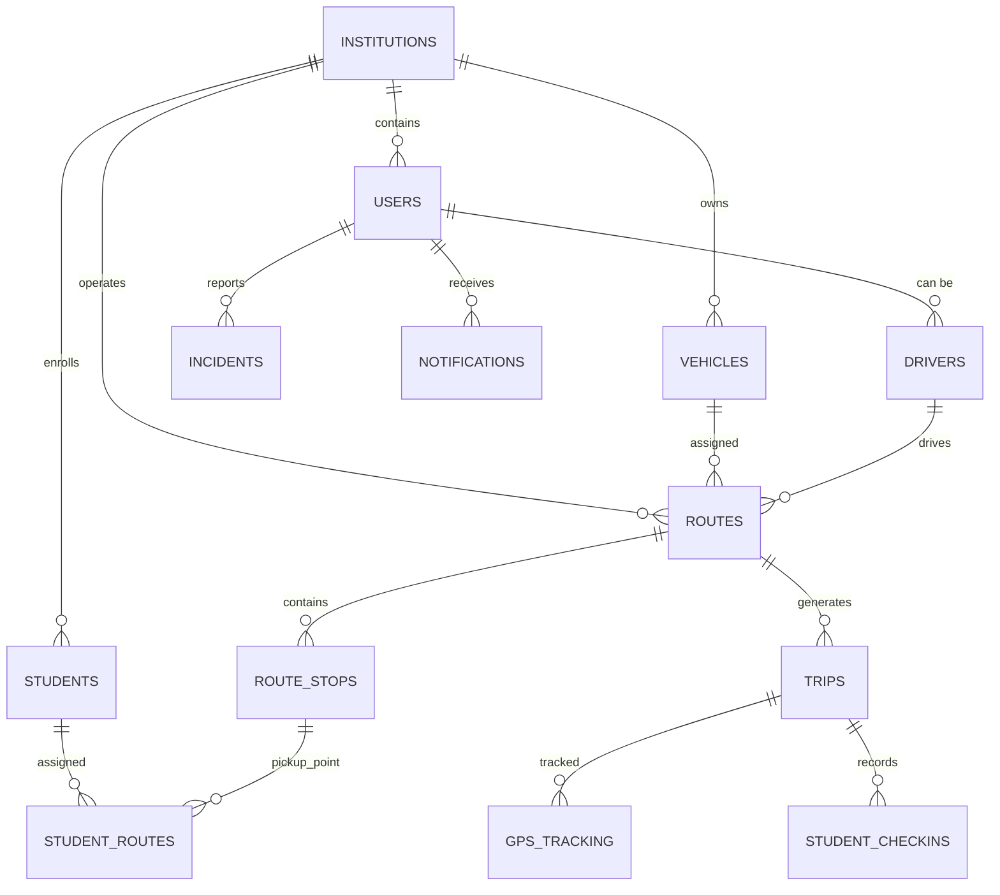

# 🗄️ Database Schema Documentation
## Altaviapp - School Transport Management Platform

**Version:** 1.0  
**Database:** Convex  
**Last Updated:** October 2025

---

## 📋 **Schema Overview**

Altaviapp uses **Convex** as its primary database, providing real-time capabilities, serverless functions, and automatic scaling. The schema is designed to support multi-tenant SaaS architecture with role-based access control.

### **Core Entity Relationships**


---

## 🏢 **Core Tables**

### **1. institutions** (Organizations/Schools)
Primary entity representing schools or corporate clients.

```sql
TABLE: institutions {
  _id: Id<"institutions">                    -- Primary key (auto-generated)
  _creationTime: number                      -- Auto-generated timestamp

  -- Basic Information
  name: string                               -- "Colegio San Francisco"
  type: "school" | "corporate"               -- Organization type
  address: string                            -- Full address
  city: string                               -- City name
  phone: string                              -- Contact phone
  email: string                              -- Official email
  contactPerson: string                      -- Primary contact name

  -- School Location (for route calculation)
  schoolLatitude?: number                    -- GPS latitude of school
  schoolLongitude?: number                   -- GPS longitude of school
  schoolAddress?: string                     -- Full school address

  -- Business Status
  isActive: boolean                          -- Active/suspended status
  subscriptionPlan: "trial" | "basic" | "professional" | "enterprise"
  subscriptionStatus: "active" | "suspended" | "cancelled"

  -- Audit
  createdAt: number                          -- Registration timestamp
  updatedAt: number                          -- Last modification
}

-- Indexes
.index("by_city", ["city"])                 -- Search by location
.index("by_status", ["isActive"])           -- Filter active institutions
.index("by_subscription", ["subscriptionStatus"]) -- Billing queries
```

### **2. users** (System Users)
All users across the platform with role-based access.

```sql
TABLE: users {
  _id: Id<"users">                          -- Primary key
  _creationTime: number                     -- Auto-generated
  
  -- Authentication (Clerk Integration)
  clerkId: string                           -- Clerk user identifier (unique)
  email: string                             -- User email (unique)
  name: string                              -- Full name
  
  -- Authorization
  role: "super_admin" | "admin" | "driver" | "parent"
  institutionId?: Id<"institutions">        -- null for super_admin
  
  -- Status
  isActive: boolean                         -- Account status
  lastLoginAt?: number                      -- Last login timestamp
  
  -- Profile
  phone?: string                            -- Contact phone
  profileImageUrl?: string                  -- Avatar URL
  
  -- Preferences
  language: "es" | "en"                     -- Interface language
  timezone: string                          -- User timezone
  notificationPreferences: {
    email: boolean
    push: boolean
    whatsapp: boolean
  }
  
  -- Audit
  createdAt: number
  updatedAt: number
}

-- Indexes
.index("by_clerk_id", ["clerkId"])          -- Authentication lookup
.index("by_email", ["email"])               -- Email search
.index("by_institution", ["institutionId"]) -- Institution users
.index("by_role", ["role"])                 -- Role-based queries
```

### **3. vehicles** (Fleet Management)
Physical vehicles in the fleet.

```sql
TABLE: vehicles {
  _id: Id<"vehicles">
  _creationTime: number
  
  -- Ownership
  institutionId: Id<"institutions">         -- Owner institution
  
  -- Vehicle Information
  licensePlate: string                      -- Unique identifier
  brand: string                             -- "Toyota", "Chevrolet"
  model: string                             -- "Hiace", "Express"
  year: number                              -- Manufacturing year
  color: string                             -- Vehicle color
  
  -- Capacity
  capacity: number                          -- Maximum students
  wheelchairAccessible: boolean             -- Accessibility feature
  
  -- Status
  status: "active" | "maintenance" | "out_of_service" | "retired"
  isActive: boolean                         -- Overall availability
  
  -- Documentation
  documents: {
    soat?: {                                -- Mandatory insurance
      expiryDate: number
      documentUrl?: string
    }
    technicalReview?: {                     -- Technical inspection
      expiryDate: number  
      documentUrl?: string
    }
    operationPermit?: {                     -- Transport permit
      expiryDate: number
      documentUrl?: string
    }
  }
  
  -- Maintenance
  lastMaintenanceDate?: number
  nextMaintenanceDate?: number
  totalMileage?: number
  
  -- Assets
  imageUrls: string[]                       -- Vehicle photos (max 5)
  
  -- Audit
  createdAt: number
  updatedAt: number
}

-- Indexes
.index("by_institution", ["institutionId"])
.index("by_status", ["status"])
.index("by_plate", ["licensePlate"])        -- Quick lookup
```

### **4. drivers** (Driver Profiles)
Driver-specific information linked to users.

```sql
TABLE: drivers {
  _id: Id<"drivers">
  _creationTime: number
  
  -- Relationships
  userId: Id<"users">                       -- Links to users table
  institutionId: Id<"institutions">         -- Employer
  
  -- License Information
  licenseNumber: string                     -- Driver's license
  licenseCategory: string                   -- "C2", "C3", etc.
  licenseExpiry: number                     -- Expiration date
  
  -- Contact & Emergency
  phone: string                             -- Direct contact
  emergencyContactName: string              -- Emergency contact
  emergencyContactPhone: string             -- Emergency phone
  
  -- Employment
  employeeId?: string                       -- Internal employee ID
  startDate: number                         -- Employment start
  endDate?: number                          -- Employment end (if applicable)
  
  -- Performance Metrics
  totalTrips: number                        -- Career trip count
  averageRating: number                     -- Parent ratings (1-5)
  punctualityScore: number                  -- Percentage (0-100)
  
  -- Certifications
  certifications: {
    defensiveDriving?: {
      issueDate: number
      expiryDate: number
      certificateUrl?: string
    }
    firstAid?: {
      issueDate: number
      expiryDate: number
      certificateUrl?: string
    }
    medicalCertificate?: {
      issueDate: number
      expiryDate: number
      certificateUrl?: string
    }
  }
  
  -- Status
  isActive: boolean
  currentVehicleId?: Id<"vehicles">         -- Currently assigned vehicle
  
  -- Audit
  createdAt: number
  updatedAt: number
}

-- Indexes
.index("by_user", ["userId"])               -- Link to user account
.index("by_institution", ["institutionId"])
.index("by_license", ["licenseNumber"])     -- Compliance checks
.index("by_vehicle", ["currentVehicleId"])  -- Current assignments
```

### **5. students** (Student Profiles)
Students who use the transport service.

```sql
TABLE: students {
  _id: Id<"students">
  _creationTime: number
  
  -- Relationships
  institutionId: Id<"institutions">         -- School/organization
  
  -- Personal Information
  firstName: string                         -- Student first name
  lastName: string                          -- Student last name
  dateOfBirth: number                       -- Birth date (timestamp)
  grade: string                             -- "5th Grade", "Kinder"
  studentId?: string                        -- School internal ID
  
  -- Address
  homeAddress: string                       -- Full home address
  homeLatitude?: number                     -- GPS coordinates
  homeLongitude?: number                    -- GPS coordinates
  
  -- Parent/Guardian Information
  parentName: string                        -- Primary parent/guardian
  parentPhone: string                       -- WhatsApp number (+593XXXXXXXXX)
  parentEmail: string                       -- Contact email
  secondaryParentName?: string              -- Second parent/guardian
  secondaryParentPhone?: string             -- Secondary contact
  
  -- Emergency Contacts
  emergencyContacts: Array<{
    name: string
    relationship: string                    -- "Grandmother", "Uncle"
    phone: string
    canPickup: boolean                      -- Authorized to pick up
  }>
  
  -- Medical Information
  medicalInfo?: {
    allergies?: string[]                    -- Known allergies
    medications?: string[]                  -- Regular medications
    specialNeeds?: string                   -- Special requirements
    bloodType?: string                      -- Blood type
  }
  
  -- Transport Authorization
  qrCode: string                           -- Unique QR identifier
  canExitAlone: boolean                    -- Can exit without parent
  authorizedPickupPersons: Array<{
    name: string
    relationship: string
    phone: string
    idDocument: string                     -- Government ID
    photoUrl?: string                      -- Photo for verification
  }>
  
  -- Status
  isActive: boolean                        -- Currently enrolled
  transportStatus: "active" | "suspended" | "temporary_hold"
  
  -- Assets
  photoUrl?: string                        -- Student photo (with permission)
  
  -- Audit
  createdAt: number
  updatedAt: number
}

-- Indexes
.index("by_institution", ["institutionId"])
.index("by_qr_code", ["qrCode"])            -- QR lookup (unique)
.index("by_parent_phone", ["parentPhone"])  -- Parent communication
.index("by_grade", ["institutionId", "grade"]) -- Grade-based queries
.index("by_name", ["firstName", "lastName"]) -- Name search
```

---

## 🗺️ **Route Management Tables**

### **6. routes** (Transport Routes)
Defined transportation routes for pickup/dropoff.

```sql
TABLE: routes {
  _id: Id<"routes">
  _creationTime: number

  -- Relationships
  institutionId: Id<"institutions">         -- Owner institution
  vehicleId: Id<"vehicles">                 -- Assigned vehicle
  driverId: Id<"drivers">                   -- Primary driver
  monitorId?: Id<"monitors">                -- Optional monitor
  backupDriverId?: Id<"drivers">            -- Backup driver

  -- Route Definition
  name: string                              -- "Ruta Norte AM"
  description?: string                      -- Additional details
  type: "pickup" | "dropoff"                -- Route direction

  -- Schedule
  scheduledStartTime: string                -- "07:00" (24h format)
  scheduledEndTime: string                  -- "08:30"
  schoolArrivalTime?: string                -- Target arrival at school (for pickup routes)
  schoolDepartureTime?: string              -- Departure from school (for dropoff routes)

  -- Recurrence Configuration (NEW)
  recurrence?: {
    type: "daily" | "weekly" | "monthly" | "one_time"
    daysOfWeek?: string[]                   -- ["monday", "tuesday", ...] for daily
    dayOfWeek?: string                      -- "monday" for weekly
    dayOfMonth?: number                     -- 1-31 for monthly
    specificDate?: string                   -- "YYYY-MM-DD" for one_time
  }

  -- Route Optimization Data (NEW)
  optimizedPolyline?: string                -- Encoded polyline from Directions API
  estimatedDuration?: number                -- Minutes (calculated by Google Maps)
  estimatedDistance?: number                -- Meters (calculated by Google Maps)

  -- Route Metrics
  totalStops: number                        -- Number of stops
  maxCapacity: number                       -- Maximum students
  currentOccupancy: number                  -- Currently assigned students

  -- Status
  isActive: boolean                         -- Currently operational
  status: "active" | "suspended" | "under_review"

  -- Audit
  createdAt: number
  updatedAt: number
}

-- Indexes
.index("by_institution", ["institutionId"])
.index("by_vehicle", ["vehicleId"])
.index("by_driver", ["driverId"])
.index("by_type", ["type"])
.index("by_status", ["isActive"])
```

### **7. routeStops** (Route Stop Points)
Individual stops along a route.

```sql
TABLE: routeStops {
  _id: Id<"routeStops">
  _creationTime: number

  -- Relationships
  routeId: Id<"routes">                     -- Parent route

  -- Stop Information
  name: string                              -- "Parada Calle 80"
  address: string                           -- Full address
  landmark?: string                         -- "Frente al parque"

  -- GPS Coordinates
  latitude: number                          -- Precise location
  longitude: number                         -- Precise location

  -- Schedule
  scheduledTime: string                     -- "07:15" (24h format)
  estimatedArrivalTime?: string             -- Calculated ETA "07:12" (NEW)
  durationFromPrevious?: number             -- Seconds from previous stop (NEW)

  -- Stop Configuration
  order: number                             -- Stop sequence (1, 2, 3...)
  geofenceRadius: number                    -- Meters (default: 100)

  -- Status
  isActive: boolean                         -- Currently operational

  -- Audit
  createdAt: number
  updatedAt: number
}

-- Indexes
.index("by_route", ["routeId"])
.index("by_order", ["routeId", "order"])    -- Ordered stops
.index("by_location", ["latitude", "longitude"]) -- Geo queries
```

### **8. studentRoutes** (Student-Route Assignments)
Links students to their assigned routes and stops.

```sql
TABLE: studentRoutes {
  _id: Id<"studentRoutes">
  _creationTime: number

  -- Relationships
  studentId: Id<"students">                 -- Student assignment
  routeId: Id<"routes">                     -- Assigned route
  stopId: Id<"routeStops">                  -- Assigned stop for pickup/dropoff

  -- Permanent Schedule Exceptions (NEW)
  excludeDays?: string[]                    -- Days student does NOT travel
                                            -- e.g., ["friday", "saturday"]
                                            -- Used for permanent exclusions

  -- Status
  isActive: boolean                         -- Currently active

  -- Audit
  createdAt: number
  updatedAt: number
}

-- Indexes
.index("by_student", ["studentId"])
.index("by_route", ["routeId"])
.index("by_pickup_stop", ["pickupStopId"])
.index("by_active", ["isActive"])
```

---

## 🚌 **Operations Tables**

### **9. trips** (Daily Route Executions)
Individual instances of route execution.

```sql
TABLE: trips {
  _id: Id<"trips">
  _creationTime: number
  
  -- Relationships
  routeId: Id<"routes">                     -- Executed route
  driverId: Id<"drivers">                   -- Driver who drove
  vehicleId: Id<"vehicles">                 -- Vehicle used
  
  -- Trip Details
  scheduledDate: string                     -- "2025-10-20" (YYYY-MM-DD)
  scheduledStartTime: string                -- Planned start time
  scheduledEndTime: string                  -- Planned end time
  
  -- Actual Execution
  actualStartTime?: number                  -- Real start timestamp
  actualEndTime?: number                    -- Real end timestamp
  startLocation?: {                         -- Start GPS
    latitude: number
    longitude: number
  }
  endLocation?: {                           -- End GPS
    latitude: number
    longitude: number
  }
  
  -- Trip Status
  status: "scheduled" | "in_progress" | "completed" | "cancelled" | "emergency"
  
  -- Metrics
  totalDistance?: number                    -- Actual kilometers
  averageSpeed?: number                     -- km/h
  totalStudentsPickedUp: number             -- Students transported
  totalStopsCompleted: number               -- Stops visited
  
  -- Quality Metrics
  punctualityScore?: number                 -- Percentage on-time
  parentSatisfactionRating?: number         -- Average parent rating
  
  -- Issues & Notes
  incidents: Id<"incidents">[]              -- Related incidents
  driverNotes?: string                      -- Driver observations
  weatherConditions?: string                -- Weather impact
  trafficConditions?: "light" | "moderate" | "heavy"
  
  -- Pre-trip Checklist
  preTripChecklist?: {
    vehicleInspection: boolean
    documentationCheck: boolean
    safetyEquipmentCheck: boolean
    communicationDeviceCheck: boolean
    completedAt: number
    completedBy: Id<"drivers">
  }
  
  -- Audit
  createdAt: number
  updatedAt: number
}

-- Indexes
.index("by_route", ["routeId"])
.index("by_driver", ["driverId"])
.index("by_date", ["scheduledDate"])
.index("by_status", ["status"])
.index("by_date_route", ["scheduledDate", "routeId"]) -- Daily operations
```

### **10. gpsTracking** (Real-time Location Data)
GPS tracking points during trips.

```sql
TABLE: gpsTracking {
  _id: Id<"gpsTracking">
  _creationTime: number
  
  -- Relationships
  tripId: Id<"trips">                       -- Associated trip
  
  -- Location Data
  latitude: number                          -- GPS latitude
  longitude: number                         -- GPS longitude
  altitude?: number                         -- Elevation (meters)
  accuracy?: number                         -- GPS accuracy (meters)
  
  -- Movement Data
  speed?: number                            -- km/h
  heading?: number                          -- Compass direction (0-360)
  
  -- Timestamps
  timestamp: number                         -- Location timestamp
  serverTimestamp: number                   -- Server receive time
  
  -- Quality Indicators
  signalStrength?: number                   -- GPS signal quality
  batteryLevel?: number                     -- Device battery %
  
  -- Calculated Fields
  distanceFromRoute?: number                -- Meters from planned route
  nearestStopId?: Id<"routeStops">         -- Closest stop
  distanceToNextStop?: number               -- Meters to next stop
  estimatedArrivalTime?: number             -- ETA to next stop
}

-- Indexes
.index("by_trip", ["tripId"])
.index("by_timestamp", ["tripId", "timestamp"]) -- Time-ordered tracking
.index("by_recent", ["timestamp"])           -- Recent locations
```

### **11. studentCheckins** (Student Boarding Records)
Records of student pickups and dropoffs.

```sql
TABLE: studentCheckins {
  _id: Id<"studentCheckins">
  _creationTime: number
  
  -- Relationships
  tripId: Id<"trips">                       -- Trip instance
  studentId: Id<"students">                 -- Student involved
  stopId: Id<"routeStops">                 -- Stop location
  driverId: Id<"drivers">                   -- Driver who recorded
  
  -- Check-in Details
  checkinType: "pickup" | "dropoff"         -- Action type
  timestamp: number                         -- Exact time of check-in
  
  -- Location Verification
  latitude: number                          -- GPS at check-in
  longitude: number                         -- GPS at check-in
  distanceFromStop: number                  -- Meters from designated stop
  
  -- Verification Method
  qrScanned: boolean                        -- Used QR code
  manualEntry: boolean                      -- Manual confirmation
  photoTaken: boolean                       -- Photo verification
  
  -- Parent/Guardian Info (for dropoffs)
  receivedBy?: {
    name: string                           -- Person who received student
    relationship: string                   -- "Mother", "Grandmother"
    idVerified: boolean                    -- ID checked
    authorizedPickup: boolean              -- Was on authorized list
  }
  
  -- Special Circumstances
  notes?: string                           -- Additional observations
  late: boolean                            -- Student was late
  noShow: boolean                          -- Student didn't appear
  earlyPickup: boolean                     -- Picked up before stop
  
  -- Quality Assurance
  parentNotified: boolean                  -- WhatsApp sent
  notificationSentAt?: number              -- Notification timestamp
  parentConfirmed?: boolean                -- Parent acknowledged
  
  -- Media Evidence
  photoUrl?: string                        -- Check-in photo
  signatureUrl?: string                    -- Digital signature (dropoff)
  
  -- Audit
  createdAt: number
  updatedAt: number
}

-- Indexes
.index("by_trip", ["tripId"])
.index("by_student", ["studentId"])
.index("by_date", ["timestamp"])
.index("by_type", ["checkinType"])
.index("by_student_date", ["studentId", "timestamp"]) -- Student history
```

---

## 🚨 **Safety & Incident Management**

### **12. incidents** (Safety Incidents & Reports)
All safety incidents, emergencies, and reports.

```sql
TABLE: incidents {
  _id: Id<"incidents">
  _creationTime: number
  
  -- Relationships
  institutionId: Id<"institutions">         -- Reporting institution
  tripId?: Id<"trips">                     -- Related trip (if applicable)
  reportedBy: Id<"users">                  -- Who reported
  assignedTo?: Id<"users">                 -- Who's handling it
  
  -- Incident Classification
  type: "accident" | "breakdown" | "behavior" | "emergency" | "medical" | "security" | "other"
  severity: "low" | "medium" | "high" | "critical"
  category: "vehicle" | "student" | "driver" | "route" | "external"
  
  -- Incident Details
  title: string                            -- Brief description
  description: string                      -- Detailed description
  
  -- Location Information
  location?: string                        -- Address or description
  latitude?: number                        -- GPS coordinates
  longitude?: number                       -- GPS coordinates
  nearestStopId?: Id<"routeStops">        -- Closest route stop
  
  -- Timing
  incidentTime: number                     -- When incident occurred
  reportedTime: number                     -- When it was reported
  responseTime?: number                    -- Emergency response time
  
  -- People Involved
  studentsInvolved: Id<"students">[]       -- Affected students
  driversInvolved: Id<"drivers">[]         -- Involved drivers
  externalPartiesInvolved?: string[]       -- Other parties
  
  -- Injuries & Medical
  injuriesReported: boolean                -- Any injuries
  medicalAttentionRequired: boolean        -- Medical help needed
  hospitalTransport: boolean               -- Hospitalization
  injuryDetails?: Array<{
    personType: "student" | "driver" | "other"
    personId?: string                      -- ID if known
    injuryType: string                     -- Description
    severity: "minor" | "moderate" | "severe"
    treatmentRequired: string
  }>
  
  -- Emergency Response
  emergencyServicesNotified: boolean       -- 911 called
  emergencyServiceTypes: string[]          -- ["police", "ambulance", "fire"]
  emergencyResponseTime?: number           -- Response time in minutes
  
  -- Investigation
  status: "open" | "investigating" | "pending_review" | "resolved" | "closed"
  investigationNotes?: string              -- Investigation details
  rootCause?: string                       -- Determined cause
  correctiveActions?: string[]             -- Actions taken
  preventiveMeasures?: string[]            -- Future prevention
  
  -- Documentation
  photos: string[]                         -- Evidence photos
  documents: string[]                      -- Reports, forms
  policeReportNumber?: string              -- Official report #
  insuranceClaimNumber?: string            -- Insurance claim
  
  -- Follow-up
  parentNotificationSent: boolean          -- Parents informed
  parentNotificationTime?: number          -- When notified
  followUpRequired: boolean                -- Needs follow-up
  followUpDate?: number                    -- Scheduled follow-up
  
  -- Resolution
  resolvedAt?: number                      -- Resolution timestamp
  resolvedBy?: Id<"users">                -- Who resolved
  resolutionSummary?: string               -- Resolution details
  lessonLearned?: string                   -- Learning outcomes
  
  -- Compliance
  regulatoryReportingRequired: boolean     -- Must report to authorities
  regulatoryReportSubmitted?: boolean      -- Report submitted
  regulatoryReportNumber?: string          -- Official report number
  
  -- Audit
  createdAt: number
  updatedAt: number
}

-- Indexes
.index("by_institution", ["institutionId"])
.index("by_status", ["status"])
.index("by_severity", ["severity"])
.index("by_type", ["type"])
.index("by_date", ["incidentTime"])
.index("by_trip", ["tripId"])
.index("by_reporter", ["reportedBy"])
```

---

## 📱 **Communication & Notifications**

### **13. notifications** (System Notifications)
All platform notifications to users.

```sql
TABLE: notifications {
  _id: Id<"notifications">
  _creationTime: number
  
  -- Relationships
  userId: Id<"users">                       -- Recipient
  institutionId?: Id<"institutions">        -- Institution context
  
  -- Notification Content
  title: string                            -- Notification title
  message: string                          -- Full message content
  shortMessage?: string                    -- Truncated for mobile
  
  -- Classification
  type: "info" | "warning" | "error" | "success" | "emergency"
  category: "trip" | "student" | "vehicle" | "system" | "safety" | "billing"
  priority: "low" | "medium" | "high" | "urgent"
  
  -- Delivery Channels
  channels: {
    inApp: boolean                         -- Show in app
    email: boolean                         -- Send email
    push: boolean                          -- Push notification
    whatsapp: boolean                      -- WhatsApp message
    sms: boolean                           -- SMS message
  }
  
  -- Delivery Status
  sentAt?: number                          -- When sent
  deliveredAt?: number                     -- When delivered
  readAt?: number                          -- When read
  status: "pending" | "sent" | "delivered" | "read" | "failed"
  
  -- Related Data
  relatedEntityType?: "trip" | "student" | "vehicle" | "incident"
  relatedEntityId?: string                 -- ID of related entity
  
  -- Actions
  actionRequired: boolean                  -- Requires user action
  actionUrl?: string                       -- Deep link URL
  actionButtonText?: string                -- "View Trip", "Acknowledge"
  actionCompleted?: boolean                -- User completed action
  
  -- Rich Content
  imageUrl?: string                        -- Notification image
  deepLinkData?: {                         -- Deep link parameters
    screen: string
    params: Record<string, any>
  }
  
  -- Scheduling
  scheduledFor?: number                    -- Delayed delivery
  expiresAt?: number                       -- Auto-expire time
  
  -- Audit
  createdAt: number
  updatedAt: number
}

-- Indexes
.index("by_user", ["userId"])
.index("by_unread", ["userId", "readAt"])    -- Unread notifications
.index("by_priority", ["priority"])
.index("by_status", ["status"])
.index("by_scheduled", ["scheduledFor"])     -- Scheduled notifications
```

### **14. communicationLogs** (External Communication Tracking)
Log of all external communications (WhatsApp, SMS, Email).

```sql
TABLE: communicationLogs {
  _id: Id<"communicationLogs">
  _creationTime: number
  
  -- Relationships
  userId?: Id<"users">                     -- Recipient user
  institutionId: Id<"institutions">        -- Institution context
  
  -- Communication Details
  channel: "whatsapp" | "sms" | "email" | "push"
  recipient: string                        -- Phone/email address
  
  -- Message Content
  messageType: "pickup_notification" | "dropoff_notification" | "emergency_alert" | 
               "route_delay" | "service_announcement" | "billing_notice"
  subject?: string                         -- Email subject
  content: string                          -- Message content
  templateUsed?: string                    -- Template identifier
  
  -- Delivery Status
  status: "pending" | "sent" | "delivered" | "failed" | "bounced"
  sentAt?: number                          -- Send timestamp
  deliveredAt?: number                     -- Delivery confirmation
  failureReason?: string                   -- Error message
  
  -- External Provider Data
  externalMessageId?: string               -- Provider message ID
  externalStatus?: string                  -- Provider status
  cost?: number                            -- Message cost (if applicable)
  
  -- Related Context
  relatedTripId?: Id<"trips">             -- Related trip
  relatedStudentId?: Id<"students">       -- Related student
  relatedIncidentId?: Id<"incidents">     -- Related incident
  
  -- Retry Logic
  retryCount: number                       -- Delivery attempts
  maxRetries: number                       -- Maximum attempts
  nextRetryAt?: number                     -- Next retry time
  
  -- Audit
  createdAt: number
  updatedAt: number
}

-- Indexes
.index("by_institution", ["institutionId"])
.index("by_status", ["status"])
.index("by_channel", ["channel"])
.index("by_date", ["sentAt"])
.index("by_recipient", ["recipient"])
.index("by_retry", ["nextRetryAt"])          -- Retry queue
```

---

## 📊 **Analytics & Reporting**

### **15. analyticsEvents** (User Behavior Tracking)
Track user interactions for product analytics.

```sql
TABLE: analyticsEvents {
  _id: Id<"analyticsEvents">
  _creationTime: number
  
  -- User Context
  userId?: Id<"users">                     -- User (if logged in)
  institutionId?: Id<"institutions">       -- Institution context
  sessionId: string                        -- User session
  
  -- Event Details
  eventName: string                        -- "route_viewed", "student_checked_in"
  eventCategory: "navigation" | "action" | "error" | "performance"
  
  -- Event Properties
  properties: Record<string, any>          -- Custom event data
  
  -- Device/Browser Info
  userAgent?: string                       -- Browser info
  platform: "web" | "mobile_web" | "pwa"
  deviceType: "desktop" | "tablet" | "mobile"
  
  -- Performance Data
  loadTime?: number                        -- Page load time
  timestamp: number                        -- Event timestamp
  
  -- Geographic Data
  country?: string                         -- User country
  city?: string                           -- User city
  
  -- Audit
  createdAt: number
}

-- Indexes
.index("by_user", ["userId"])
.index("by_institution", ["institutionId"])
.index("by_event", ["eventName"])
.index("by_date", ["timestamp"])
.index("by_session", ["sessionId"])
```

### **16. performanceMetrics** (System Performance Tracking)
Track system performance and reliability metrics.

```sql
TABLE: performanceMetrics {
  _id: Id<"performanceMetrics">
  _creationTime: number
  
  -- Metric Details
  metricName: string                       -- "gps_update_latency", "api_response_time"
  metricType: "latency" | "throughput" | "error_rate" | "availability"
  
  -- Metric Values
  value: number                            -- Metric value
  unit: string                             -- "ms", "requests/sec", "%"
  
  -- Context
  institutionId?: Id<"institutions">       -- Institution-specific
  component: string                        -- "gps_tracking", "notifications"
  environment: "production" | "staging" | "development"
  
  -- Aggregation Level
  aggregationLevel: "minute" | "hour" | "day"
  timestamp: number                        -- Metric timestamp
  
  -- Threshold Monitoring
  threshold?: number                       -- Alert threshold
  thresholdExceeded: boolean              -- Threshold violation
  
  -- Additional Data
  metadata?: Record<string, any>          -- Additional context
  
  -- Audit
  createdAt: number
}

-- Indexes
.index("by_metric", ["metricName"])
.index("by_timestamp", ["timestamp"])
.index("by_component", ["component"])
.index("by_threshold", ["thresholdExceeded"])
```

---

## 🔐 **Security & Audit**

### **17. auditLogs** (Security Audit Trail)
Complete audit trail of all system actions.

```sql
TABLE: auditLogs {
  _id: Id<"auditLogs">
  _creationTime: number
  
  -- Actor Information
  userId?: Id<"users">                     -- Who performed action
  userRole?: string                        -- User role at time of action
  institutionId?: Id<"institutions">       -- Institution context
  
  -- Action Details
  action: string                           -- "create_student", "delete_vehicle"
  resourceType: string                     -- "student", "vehicle", "route"
  resourceId?: string                      -- ID of affected resource
  
  -- Request Context
  ipAddress?: string                       -- Source IP
  userAgent?: string                       -- Browser/device info
  sessionId?: string                       -- User session
  
  -- Change Details
  previousValues?: Record<string, any>     -- Before changes
  newValues?: Record<string, any>          -- After changes
  changeReason?: string                    -- Reason for change
  
  -- Result
  success: boolean                         -- Action succeeded
  errorMessage?: string                    -- Error details (if failed)
  
  -- Security Classification
  riskLevel: "low" | "medium" | "high"    -- Security risk assessment
  sensitiveData: boolean                   -- Contains sensitive info
  
  -- Timestamp
  timestamp: number                        -- Action timestamp
  
  -- Audit
  createdAt: number
}

-- Indexes
.index("by_user", ["userId"])
.index("by_institution", ["institutionId"])
.index("by_action", ["action"])
.index("by_resource", ["resourceType", "resourceId"])
.index("by_timestamp", ["timestamp"])
.index("by_risk", ["riskLevel"])
```

### **18. accessTokens** (API Access Management)
Manage API access tokens and permissions.

```sql
TABLE: accessTokens {
  _id: Id<"accessTokens">
  _creationTime: number
  
  -- Token Details
  tokenHash: string                        -- Hashed token value
  tokenName: string                        -- Human-readable name
  
  -- Ownership
  userId: Id<"users">                      -- Token owner
  institutionId?: Id<"institutions">       -- Scope limitation
  
  -- Permissions
  permissions: string[]                    -- Allowed actions
  scope: "full" | "read_only" | "limited" -- Access level
  
  -- Usage Limits
  rateLimitPerHour?: number               -- Requests per hour
  rateLimitPerDay?: number                -- Requests per day
  usageCount: number                      -- Total usage
  
  -- Status
  isActive: boolean                       -- Token active
  expiresAt?: number                      -- Expiration time
  lastUsedAt?: number                     -- Last usage
  
  -- Security
  allowedIPs?: string[]                   -- IP restrictions
  requiredHeaders?: Record<string, string> -- Required headers
  
  -- Audit
  createdAt: number
  updatedAt: number
}

-- Indexes
.index("by_token", ["tokenHash"])          -- Token lookup
.index("by_user", ["userId"])
.index("by_active", ["isActive"])
.index("by_expiry", ["expiresAt"])
```

---

## 🔧 **System Configuration**

### **19. systemSettings** (Global Configuration)
System-wide configuration and feature flags.

```sql
TABLE: systemSettings {
  _id: Id<"systemSettings">
  _creationTime: number
  
  -- Setting Details
  key: string                              -- "max_gps_update_interval"
  value: any                               -- Setting value
  dataType: "string" | "number" | "boolean" | "json"
  
  -- Context
  scope: "global" | "institution" | "user"
  institutionId?: Id<"institutions">       -- Institution-specific
  userId?: Id<"users">                     -- User-specific
  
  -- Metadata
  description: string                      -- Setting description
  category: "performance" | "security" | "features" | "limits"
  isPublic: boolean                        -- Visible to non-admins
  
  -- Validation
  validationRules?: {
    min?: number
    max?: number
    pattern?: string
    allowedValues?: any[]
  }
  
  -- Management
  lastModifiedBy: Id<"users">             -- Who changed it
  changeReason?: string                    -- Why changed
  
  -- Audit
  createdAt: number
  updatedAt: number
}

-- Indexes
.index("by_key", ["key"])
.index("by_scope", ["scope"])
.index("by_institution", ["institutionId"])
.index("by_category", ["category"])
```

---

## 📋 **Schema Summary**

### **Total Tables: 19**

| Category | Tables | Purpose |
|----------|--------|---------|
| **Core** | 5 | institutions, users, vehicles, drivers, students |
| **Routes** | 4 | routes, routeStops, studentRoutes, trips |
| **Operations** | 2 | gpsTracking, studentCheckins |
| **Safety** | 1 | incidents |
| **Communication** | 2 | notifications, communicationLogs |
| **Analytics** | 2 | analyticsEvents, performanceMetrics |
| **Security** | 2 | auditLogs, accessTokens |
| **System** | 1 | systemSettings |

### **Key Relationships**
- **1:Many**: Institution → Users, Vehicles, Students, Routes
- **Many:Many**: Students ↔ Routes (via studentRoutes)
- **1:Many**: Routes → Trips → GPS Tracking Points
- **1:Many**: Trips → Student Check-ins
- **Self-Reference**: Users (manager hierarchy)

### **Data Retention Policies**
- **GPS Tracking**: 12 months (archive older data)
- **Student Check-ins**: 3 years (compliance requirement)
- **Audit Logs**: 7 years (security requirement)
- **Analytics Events**: 2 years (business intelligence)
- **Communication Logs**: 1 year (legal requirement)

### **Performance Considerations**
- **Hot Data**: Current trips, real-time GPS (SSD storage)
- **Warm Data**: Recent trips, notifications (standard storage)
- **Cold Data**: Historical analytics, old audit logs (archive storage)
- **Indexing**: All foreign keys, timestamp fields, status fields
- **Partitioning**: Large tables by date (gpsTracking, auditLogs)

---

**This schema is designed for scalability, supporting thousands of institutions with millions of students while maintaining real-time performance for GPS tracking and instant notifications.** 🚌✨