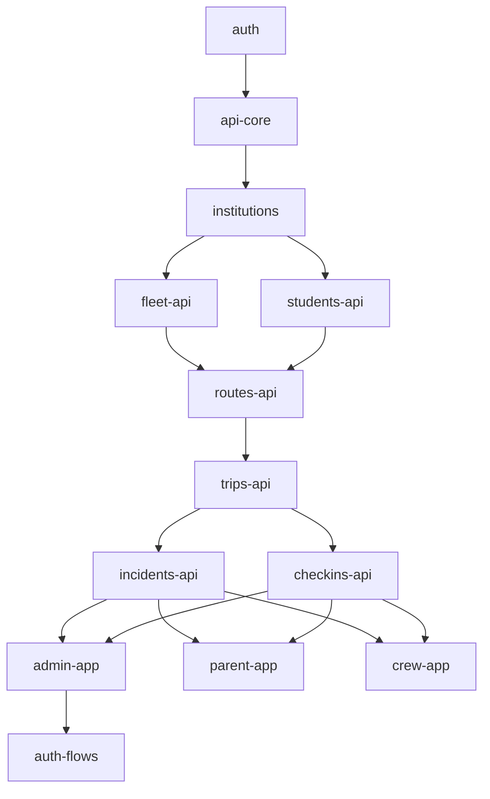

# Altaviapp Module Implementation Order

**Development Roadmap with Dependencies**
**Version**: 1.1
**Date**: December 2025
**Last Updated**: December 10, 2025
**Total Duration**: ~12 weeks (3 months)

---

## 🎯 Current Implementation Status

| Phase | Status | Progress |
|-------|--------|----------|
| **Phase 1: Foundation** | ✅ COMPLETE | 100% |
| **Phase 2: Backend APIs** | ✅ COMPLETE | 100% |
| **Phase 3: Frontends** | 🚧 IN PROGRESS | ~97% |

### Phase 3 Detailed Status

| Module | Status | Progress | Notes |
|--------|--------|----------|-------|
| admin-app | 🚧 In Progress | ~97% | Full Convex hooks, reports + novedades approval complete |
| parent-app | 🚧 In Progress | ~90% | Convex hooks + novedades complete, needs Google Maps |
| crew-app | ✅ Complete | ~99% | GPS tracking + QR Scanner + novedades acknowledgment complete |
| auth-flows | 🚧 In Progress | ~60% | Auth pages created, needs testing with backend |
| **novedades** | ✅ Complete | 100% | Schedule exceptions system (Dec 10, 2025) |

### Recent Achievements (December 2025)
- ✅ Monorepo structure set up (Turborepo + pnpm)
- ✅ Google Maps package created (`packages/maps/`)
- ✅ Admin hooks connected to Convex (useFleet, useRoutes, useStudents, useTrips, useIncidents)
- ✅ Route management components (AddStopModal, RouteOptimizer, StudentAssignment)
- ✅ Seed data created for La Carolina/Floresta, Quito
- ✅ All TypeScript errors resolved in all three apps
- ✅ **Parent-app Convex integration complete** (useMyStudents, useStudentTracking, useNotifications)
- ✅ **Crew-app Convex integration complete** (useMyTrips, useTripOperations, useConvexCheckins, useConvexDashboard)
- ✅ **Real auth integration** with fallback to mock data for UI development
- ✅ **GPS Tracking implementation complete** (useGPSTracking hook with Geolocation API)
  - Browser watchPosition with 15-second updates to Convex
  - Battery-efficient modes (high accuracy / battery saver)
  - GPSStatusIndicator component (compact/detailed variants)
  - Geofence alerts from backend
  - Browser notifications for stop arrival
  - Auto-start/stop tracking with trip lifecycle
- ✅ **QR Scanner implementation complete** (html5-qrcode library)
  - Camera-based QR scanning for student check-ins
  - QRScanner component with flashlight toggle
  - useStudentByQR hook for validation
  - Check-in page connected to Convex mutations
- ✅ **Reports Dashboard complete** (convex/reports.ts)
  - getDashboardMetrics - key metrics aggregation
  - getDailyStats - daily trip statistics for charts
  - getTopRoutes - top performing routes
  - getTripReport - detailed trip report with filters
  - getIncidentReport - incident report with filters
  - getAttendanceReport - student attendance report
  - Admin reports page connected to real Convex data
- ✅ **Sistema de Novedades complete** (December 10, 2025)
  - Two-level route architecture (Route Base + Route Programmed)
  - `tripStudents` table for per-trip student assignments with novedades applied
  - `novedades` table for temporary exceptions (absence, parent_pickup, stop_change, etc.)
  - `routeChangeRequests` table for permanent changes requiring admin approval
  - Parent App: create/view novedades with validation (48h for stop changes)
  - Crew App: view novedades in student list with acknowledgment workflow
  - Admin App: approval page for permanent route change requests
  - Notification categories for filtering

---

## Overview

This document defines the recommended implementation order for Altaviapp modules. Each module builds on previous modules and cannot be started until its dependencies are complete.

**Module Types**:
- **Foundation** (Phase 1): Must be implemented first
- **Backend APIs** (Phase 2): Core business logic
- **Frontends** (Phase 3): User interfaces

**Implementation Strategy**:
- Sequential within phases (one module at a time)
- Can parallelize **some** modules within Phase 2 (see notes)
- All Phase 1 must be complete before Phase 2
- All Phase 2 must be complete before Phase 3

---

## Quick Reference: Module List

| # | Module | Phase | Duration | Dependencies |
|---|--------|-------|----------|--------------|
| 1 | auth | 1 | 3-5 days | None |
| 2 | api-core | 1 | 2-3 days | auth |
| 3 | institutions | 1 | 2-3 days | auth, api-core |
| 4 | fleet-api | 2 | 3-5 days | institutions |
| 5 | students-api | 2 | 4-6 days | institutions |
| 6 | routes-api | 2 | 5-7 days | institutions, fleet-api |
| 7 | trips-api | 2 | 5-7 days | routes-api, students-api |
| 8 | checkins-api | 2 | 3-5 days | trips-api |
| 9 | incidents-api | 2 | 3-4 days | trips-api |
| 10 | admin-app | 3 | 7-10 days | All Phase 2 |
| 11 | parent-app | 3 | 4-5 days | All Phase 2 |
| 12 | crew-app | 3 | 7-10 days | All Phase 2 |
| 13 | auth-flows | 3 | 3-5 days | admin-app |

**Total**: ~50-70 working days (10-14 weeks)

---

## Phase 1: Foundation (Week 1-2)

Must be implemented first. No dependencies outside this phase.

### Module 1: auth
**Duration**: 3-5 days
**Dependencies**: None (start here)

**What to implement**:
- Custom token-based authentication
- Session management (bcrypt + sessions)
- User registration and login endpoints
- getCurrentUser() helper
- requireRole() helper
- requireInstitutionAccess() helper
- Invitation system for user onboarding

**Completion criteria**:
- [ ] Users can register and sign in
- [ ] Sessions are managed securely
- [ ] Role-based helpers work correctly
- [ ] Institution access control enforced
- [ ] Invitations system functional

**Files to create**:
- `convex/auth.ts` - Auth mutations
- `convex/authApi.ts` - HTTP endpoints
- `convex/lib/authUtils.ts` - Auth helpers
- `convex/invitations.ts` - Invitation system

**Command**: `@implement auth`

---

### Module 2: api-core
**Duration**: 2-3 days
**Dependencies**: auth (must be complete)

**What to implement**:
- Standard response format (successResponse, errorResponse)
- Error classes (ApiError, BadRequestError, etc.)
- API route structure (/api/v1/*)
- Request validation setup (Zod)
- Error handling middleware
- CORS configuration

**Completion criteria**:
- [ ] Standard response format working
- [ ] Error handling consistent across endpoints
- [ ] CORS configured for frontend apps
- [ ] Validation working with Zod

**Files to create**:
- `lib/api/response.ts`
- `lib/api/errors.ts`
- `lib/validations/common.ts`
- `app/api/v1/route.ts` (base route)

**Command**: `@implement api-core`

---

### Module 3: institutions
**Duration**: 2-3 days
**Dependencies**: auth, api-core

**What to implement**:
- Institutions table (already in schema)
- Institution CRUD endpoints:
  - GET /institutions
  - POST /institutions
  - GET /institutions/:id
  - PUT /institutions/:id
  - DELETE /institutions/:id
- Institution filtering for all future queries
- Super admin vs admin permissions

**Completion criteria**:
- [ ] Can create institutions (super_admin)
- [ ] Can list institutions (filtered by access)
- [ ] Can update/delete institutions
- [ ] Multi-tenancy foundation working

**Files to create**:
- `convex/institutions.ts` - Convex queries/mutations
- `app/api/v1/institutions/route.ts` - API endpoints
- `lib/validations/institution.ts` - Zod schemas

**Command**: `@implement institutions`

**End of Phase 1** ✅

---

## Phase 2: Backend APIs (Week 3-9)

Core business logic. **Cannot start until Phase 1 is 100% complete.**

### Module 4: fleet-api
**Duration**: 3-5 days
**Dependencies**: institutions

**What to implement**:
- Vehicles CRUD endpoints:
  - GET /vehicles
  - POST /vehicles
  - GET /vehicles/:id
  - PUT /vehicles/:id
  - DELETE /vehicles/:id
  - POST /vehicles/:id/upload-document
- Drivers CRUD endpoints:
  - GET /drivers
  - POST /drivers
  - GET /drivers/:id
  - PUT /drivers/:id
  - DELETE /drivers/:id
- Document upload (SOAT, technical review, licenses)
- Expiry date validation
- Status management (active/maintenance/retired)

**Completion criteria**:
- [ ] Can create/edit vehicles
- [ ] Can create/edit drivers
- [ ] Documents upload working
- [ ] Filtered by institutionId
- [ ] Status management working

**Files to create**:
- `convex/vehicles.ts`
- `convex/drivers.ts`
- `app/api/v1/vehicles/route.ts`
- `app/api/v1/drivers/route.ts`
- `lib/validations/vehicle.ts`
- `lib/validations/driver.ts`

**Command**: `@implement fleet-api`

---

### Module 5: students-api
**Duration**: 4-6 days
**Dependencies**: institutions

**What to implement**:
- Students CRUD endpoints:
  - GET /students
  - POST /students (with QR generation)
  - GET /students/:id
  - PUT /students/:id
  - DELETE /students/:id
  - GET /students/:id/qr
  - POST /students/:id/regenerate-qr
- QR code generation (qrcode library)
- QR code validation
- Parent information management
- Emergency contacts
- Medical information
- Authorized pickup persons

**Completion criteria**:
- [ ] Can create students
- [ ] QR codes auto-generated
- [ ] QR codes can be regenerated
- [ ] Parent info properly stored
- [ ] Medical info optional but validated

**Files to create**:
- `convex/students.ts`
- `app/api/v1/students/route.ts`
- `lib/validations/student.ts`
- `lib/qr-generator.ts`

**Command**: `@implement students-api`

**Note**: Can be parallelized with fleet-api (different branches)

---

### Module 6: routes-api
**Duration**: 5-7 days
**Dependencies**: institutions, fleet-api

**What to implement**:
- Routes CRUD endpoints:
  - GET /routes
  - POST /routes
  - GET /routes/:id
  - PUT /routes/:id
  - DELETE /routes/:id
- Route Stops endpoints:
  - GET /routes/:routeId/stops
  - POST /routes/:routeId/stops
  - GET /routes/:routeId/stops/:stopId
  - PUT /routes/:routeId/stops/:stopId
  - DELETE /routes/:routeId/stops/:stopId
  - PUT /routes/:routeId/stops/reorder
- Geofencing calculation
- Route distance calculation (OSRM or manual)
- Stop ordering
- Capacity management

**Completion criteria**:
- [ ] Can create routes
- [ ] Can add stops to routes
- [ ] Stops can be reordered
- [ ] Geofencing radius configurable
- [ ] Route capacity tracked

**Files to create**:
- `convex/routes.ts`
- `convex/routeStops.ts`
- `app/api/v1/routes/route.ts`
- `app/api/v1/routes/[routeId]/stops/route.ts`
- `lib/validations/route.ts`
- `lib/geofence.ts`

**Command**: `@implement routes-api`

---

### Module 7: trips-api
**Duration**: 5-7 days
**Dependencies**: routes-api, students-api

**What to implement**:
- Trips CRUD endpoints:
  - GET /trips
  - POST /trips
  - GET /trips/:id
  - PUT /trips/:id
  - PUT /trips/:id/start
  - PUT /trips/:id/complete
  - PUT /trips/:id/cancel
  - GET /trips/active
- GPS tracking endpoints:
  - POST /trips/:tripId/location
  - GET /trips/:tripId/location
  - GET /trips/:tripId/location/history
- Student Routes endpoints:
  - POST /student-routes (assign student to route)
  - GET /student-routes/:id
  - PUT /student-routes/:id
  - DELETE /student-routes/:id
- Real-time location updates (Convex live queries)
- Geofencing detection on GPS update
- Trip status management
- Pre-trip checklist

**Completion criteria**:
- [ ] Can create trips
- [ ] Can start/complete/cancel trips
- [ ] GPS updates working
- [ ] Real-time location retrieval
- [ ] Geofencing triggers correctly
- [ ] Student route assignments working

**Files to create**:
- `convex/trips.ts`
- `convex/gpsTracking.ts`
- `convex/studentRoutes.ts`
- `convex/geofencing.ts` (internal)
- `app/api/v1/trips/route.ts`
- `app/api/v1/student-routes/route.ts`
- `lib/validations/trip.ts`

**Command**: `@implement trips-api`

---

### Module 8: checkins-api
**Duration**: 3-5 days
**Dependencies**: trips-api

**What to implement**:
- Check-ins endpoints:
  - POST /checkins
  - POST /checkins/validate-qr
  - GET /checkins
  - GET /checkins/:id
- QR code validation
- Parent notification trigger (WhatsApp)
- Location verification
- Manual vs QR check-in tracking
- Dropoff authorization (authorized persons)

**Completion criteria**:
- [ ] Can record check-ins
- [ ] QR validation working
- [ ] Parent notifications sent (WhatsApp)
- [ ] Location recorded with check-in
- [ ] Authorized person validation

**Files to create**:
- `convex/checkins.ts`
- `convex/notifications.ts` (WhatsApp)
- `app/api/v1/checkins/route.ts`
- `lib/validations/checkin.ts`
- `lib/qr-validator.ts`

**Command**: `@implement checkins-api`

---

### Module 9: incidents-api
**Duration**: 3-4 days
**Dependencies**: trips-api

**What to implement**:
- Incidents endpoints:
  - GET /incidents
  - POST /incidents
  - GET /incidents/:id
  - PUT /incidents/:id
  - PUT /incidents/:id/resolve
  - POST /incidents/:id/upload-photo
- Incident classification (type, severity, category)
- Photo upload
- Emergency notifications
- Status workflow (open → investigating → resolved → closed)

**Completion criteria**:
- [ ] Can create incident reports
- [ ] Photos can be uploaded
- [ ] Emergency incidents trigger alerts
- [ ] Status workflow functional
- [ ] Notifications sent to admins

**Files to create**:
- `convex/incidents.ts`
- `app/api/v1/incidents/route.ts`
- `lib/validations/incident.ts`

**Command**: `@implement incidents-api`

**End of Phase 2** ✅

---

## Phase 3: Frontends (Week 10-12)

User interfaces. **Cannot start until Phase 2 is 100% complete.**

**Architecture**: Monorepo with 3 Next.js PWA applications
```
/apps/
├── admin/     # Admin Dashboard (Next.js PWA)
├── parent/    # Parent Portal (Next.js PWA)
└── crew/      # Crew App (Next.js PWA) - Base de desarrollo
/packages/
├── ui/        # Shared UI components (shadcn/ui)
├── auth/      # Shared auth utilities
├── pwa/       # Shared PWA utilities (service worker, manifest, offline)
└── convex-client/  # Shared Convex hooks & types
```

**Base de Desarrollo**: El código existente en `/mobile/` (Crew App) sirve como base para todas las apps. Reutilizar:
- Estructura de proyecto Next.js 14+
- Configuración PWA (manifest, service worker)
- Componentes UI (shadcn/ui)
- Hooks de autenticación
- Providers (Auth, Convex)

**Wireframe Documents**:
- [docs/design/ADMIN_WIREFRAMES.md](../design/ADMIN_WIREFRAMES.md)
- [docs/design/PARENT_WIREFRAMES.md](../design/PARENT_WIREFRAMES.md)
- [docs/design/CREW_WIREFRAMES.md](../design/CREW_WIREFRAMES.md)
- [docs/design/AUTH_WIREFRAMES.md](../design/AUTH_WIREFRAMES.md)

---

### Module 10: admin-app
**Duration**: 7-10 days
**Dependencies**: All Phase 2 modules
**Base**: Reutilizar estructura de `/mobile/` (Crew App)

**What to implement**:
- Admin dashboard PWA (Next.js):
  - Dashboard overview (metrics, alerts)
  - Fleet management (vehicles, drivers, monitors)
  - Route management (routes, stops, assignments)
  - Student management (students, QR codes)
  - Trip monitoring (active trips, history)
  - Incident management (reports, investigations)
  - Reports and analytics
  - Settings and configuration
  - Invitation management (super_admin)
- PWA features (installable, offline-capable)
- Real-time data display with Convex
- Filters and search
- Responsive design (desktop-first, mobile-friendly)

**Completion criteria**:
- [ ] All pages functional
- [ ] All Convex queries/mutations working
- [ ] CRUD operations complete
- [ ] Real-time data updating
- [ ] PWA installable
- [ ] Offline mode básico (view cached data)
- [ ] Admin can manage entire system

**Files to create**:
- `apps/admin/src/app/*` - Admin pages
- `apps/admin/src/components/*` - Admin components
- `apps/admin/public/manifest.json` - PWA manifest
- `apps/admin/public/sw.js` - Service worker
- `packages/ui/*` - Shared UI components

**Command**: `@implement admin-app`

**Reference**: [docs/design/ADMIN_WIREFRAMES.md](../design/ADMIN_WIREFRAMES.md)

---

### Module 11: parent-app
**Duration**: 4-5 days
**Dependencies**: All Phase 2 modules
**Base**: Reutilizar estructura de `/mobile/` (Crew App)

**What to implement**:
- Parent portal PWA (Next.js):
  - Login/signup via invitation
  - Student dashboard
  - Real-time tracking (map view)
  - Notification history
  - Trip history
  - Contact information
- PWA features (installable, offline-capable)
- Real-time GPS display (auto-refresh every 15s)
- Route progress visualization
- ETA calculation
- Push notifications
- Mobile-first design (instalable en teléfono)

**Completion criteria**:
- [ ] Parents can log in via invitation
- [ ] Can view their students
- [ ] Can track bus in real-time
- [ ] Notifications display correctly
- [ ] Map updates automatically
- [ ] PWA installable
- [ ] Push notifications working
- [ ] Offline mode (view last known location)

**Files to create**:
- `apps/parent/src/app/*` - Parent pages
- `apps/parent/src/components/*` - Parent components
- `apps/parent/public/manifest.json` - PWA manifest
- `apps/parent/public/sw.js` - Service worker

**Command**: `@implement parent-app`

**Reference**: [docs/design/PARENT_WIREFRAMES.md](../design/PARENT_WIREFRAMES.md)

**Note**: Can be parallelized with admin-app (different apps)

---

### Module 12: crew-app
**Duration**: 7-10 days
**Dependencies**: All Phase 2 modules
**Base**: Ya existe en `/mobile/` - migrar a `/apps/crew/`

**Estado Actual**:
El código base ya existe en `/mobile/` con:
- Estructura Next.js 14+ App Router
- Páginas de auth (login, welcome, permissions)
- Dashboard con role-based UI (driver/monitor)
- Componentes de viaje (checklist, active trip, map)
- Hooks de autenticación
- Mock data para desarrollo

**What to implement** (completar/migrar):
- Crew mobile PWA (Next.js):
  - Login page ✅ (existe)
  - Route selection page
  - Active trip page ✅ (existe parcialmente)
  - Pre-trip checklist page (driver only) ✅ (existe)
  - Student check-in page (QR scanner)
  - Incident report page (monitor only)
  - Trip history page
  - Profile and settings ✅ (existe parcialmente)
- Conectar con Convex real (reemplazar mocks)
- GPS tracking (continuous background updates)
- QR code scanner (camera access)
- Offline functionality:
  - Service worker
  - IndexedDB for route/student data
  - Background sync for check-ins
  - Queued GPS updates
- Push notifications
- Role-based UI (driver vs monitor) ✅ (existe)

**Completion criteria**:
- [ ] Migrado a `/apps/crew/`
- [ ] Mocks reemplazados con Convex queries
- [ ] Crew can log in
- [ ] Can select and start routes
- [ ] GPS tracking functional
- [ ] QR scanner working
- [ ] Can check in students offline
- [ ] Data syncs when back online
- [ ] Can install as app
- [ ] Push notifications working
- [ ] Role-based features work correctly

**Files to migrate/create**:
- Migrar `/mobile/src/*` → `apps/crew/src/*`
- `apps/crew/src/lib/offline-storage.ts`
- `apps/crew/src/lib/gps-tracker.ts`
- `apps/crew/src/lib/qr-scanner.ts`
- Actualizar `apps/crew/public/sw.js`
- Actualizar `apps/crew/public/manifest.json`

**Command**: `@implement crew-app`

**Reference**: [docs/design/CREW_WIREFRAMES.md](../design/CREW_WIREFRAMES.md)

---

### Module 13: auth-flows
**Duration**: 3-5 days
**Dependencies**: admin-app (shared components)

**What to implement**:
- Complete authentication UI:
  - Landing page
  - Subscription plan selection
  - Registration form (new admin + institution)
  - Login page
  - Invitation code entry
  - Set password (post-invitation)
  - Email verification
  - Password reset flow
  - Invitation management (super_admin)
- Shared auth components in packages/auth

**Completion criteria**:
- [ ] New account registration working
- [ ] Invitation flow working
- [ ] Password reset working
- [ ] Email verification working
- [ ] Super admin can manage invitations
- [ ] All auth flows match wireframes

**Files to create**:
- `packages/auth/src/*` - Shared auth components
- `apps/admin/src/app/(auth)/*` - Auth pages
- `apps/parent/src/app/(auth)/*` - Auth pages
- `apps/crew/src/app/(auth)/*` - Auth pages

**Command**: `@implement auth-flows`

**Reference**: [docs/design/AUTH_WIREFRAMES.md](../design/AUTH_WIREFRAMES.md)

**End of Phase 3** ✅

---

## Dependency Visualization

### ASCII Dependency Tree

```
Phase 1 (Foundation)
  auth
    ↓
  api-core
    ↓
  institutions

Phase 2 (Backend)
  institutions
    ↓
    ├─→ fleet-api
    │     ↓
    │   routes-api ←──┐
    │     ↓           │
    └─→ students-api ─┘
          ↓
        trips-api
          ↓
          ├─→ checkins-api
          └─→ incidents-api

Phase 3 (Frontends)
  [All Phase 2 complete]
    ↓
    ├─→ admin-app
    ├─→ parent-app
    ├─→ crew-app
    └─→ auth-flows
```

### Mermaid Diagram



---

## Parallelization Opportunities

### Can Be Parallelized (Different Branches)

**Phase 2**:
- `fleet-api` and `students-api` (no dependencies on each other)
  - Branch 1: `feature/fleet-api`
  - Branch 2: `feature/students-api`
  - Merge both before starting `routes-api`

**Phase 3**:
- `admin-app`, `parent-app`, and `crew-app` can run in parallel
  - Branch 1: `feature/admin-app`
  - Branch 2: `feature/parent-app`
  - Branch 3: `feature/crew-app`
- `auth-flows` depends on shared components from admin-app
  - Branch 4: `feature/auth-flows` (after packages/ui setup)

### Cannot Be Parallelized (Sequential)

**Phase 1**: All sequential
- auth → api-core → institutions

**Phase 2 (partial)**:
- routes-api depends on fleet-api completion
- trips-api depends on routes-api AND students-api completion
- checkins-api and incidents-api depend on trips-api

---

## Critical Path

**Longest dependency chain (critical path)**:

```
auth (5d) →
api-core (3d) →
institutions (3d) →
fleet-api (5d) →
routes-api (7d) →
trips-api (7d) →
checkins-api (5d) →
admin-app (10d) →
auth-flows (5d)

Total Critical Path: ~50 days (10 weeks)
```

**With parallelization**:
- fleet-api || students-api: Save 5 days
- All Phase 3 in parallel: Save ~5 days

**Optimized total**: ~35-40 days (7-8 weeks) with 2-3 developers

---

## Weekly Breakdown

### Week 1 ✅ COMPLETE
- [x] auth (3-5 days) - Custom token-based auth implemented
- [x] api-core (2-3 days) - HTTP endpoints, response format

### Week 2 ✅ COMPLETE
- [x] institutions (2-3 days) - Multi-tenant foundation
- [x] fleet-api (start, 3-5 days) - Vehicles and drivers CRUD

### Week 3 ✅ COMPLETE
- [x] fleet-api (complete) - Including monitors
- [x] students-api (start, 4-6 days) - Students CRUD with QR generation

### Week 4 ✅ COMPLETE
- [x] students-api (complete) - Parent info, medical info
- [x] routes-api (start, 5-7 days) - Routes and stops CRUD

### Week 5 ✅ COMPLETE
- [x] routes-api (complete) - Geofencing, reorder stops
- [x] trips-api (start, 5-7 days) - Trip management, GPS tracking

### Week 6-7 ✅ COMPLETE
- [x] trips-api (complete) - Student routes, live tracking
- [x] checkins-api (3-5 days) - QR validation, check-in/out
- [x] incidents-api (3-4 days) - Incident reporting

### Week 8-9 🚧 IN PROGRESS
- [x] admin-app structure (Turborepo monorepo setup)
- [x] admin-app hooks (useFleet, useRoutes, useStudents connected to Convex)
- [x] admin-app route components (AddStopModal, RouteOptimizer, StudentAssignment)
- [ ] admin-app remaining pages (fleet, trips, incidents - UI complete, need Convex)

### Week 10 ✅ COMPLETE
- [x] parent-app structure (pages created)
- [x] parent-app Convex connection (useMyStudents, useNotifications, useStudentTracking)
- [ ] parent-app real-time tracking (needs Google Maps integration)

### Week 11-12 ✅ MOSTLY COMPLETE
- [x] crew-app structure (pages created)
- [x] crew-app Convex connection (all hooks connected)
- [x] crew-app GPS tracking ✅ COMPLETE
  - useGPSTracking hook with Geolocation API
  - GPSStatusIndicator component
  - Integration in active trip page
- [x] crew-app QR scanner ✅ COMPLETE
  - html5-qrcode library
  - QRScanner component with camera access
  - useStudentByQR hook for validation
  - Check-in page with Convex mutations
- [x] admin-app reports ✅ COMPLETE
  - convex/reports.ts with 6 aggregation queries
  - useReports hooks for frontend
  - Reports page connected to Convex
- [x] auth-flows pages (login, signup, invitation for all apps)
- [ ] auth-flows complete integration (testing)

### Remaining Tasks (Priority Order)
1. 🗺️ **Google Maps in Parent App** - Integrate LiveTrackingMap component in parent tracking page
2. 🔐 **Auth Testing** - End-to-end login/signup testing with real backend
3. 📱 **PWA Finalization** - Service worker, offline mode, push notifications
4. 🧪 **Integration Testing** - Full flow testing across all apps

**Completed This Week**:
- ✅ Sistema de Novedades (schedule exceptions) - Full implementation

**Total**: 12-13 weeks (3 months)
**Current Progress**: Week 12 (~97% overall)

---

## Blockers and Risks

### Potential Blockers

1. **Auth system complexity** (Module 1)
   - Mitigation: Auth system already implemented, review existing code

2. **Convex schema issues** (Module 3)
   - Mitigation: Schema already defined, just need to deploy

3. **QR code library integration** (Module 5)
   - Mitigation: Test QR generation early

4. **GPS tracking accuracy** (Module 7)
   - Mitigation: Test on real devices early

5. **Monorepo setup complexity** (Phase 3)
   - Mitigation: Set up Turborepo + pnpm early, test shared packages

6. **PWA offline sync complexity** (Module 12)
   - Mitigation: Prototype service worker early

### Risk Mitigation Strategies

- **Start each module with spike/prototype** for complex features
- **Test on real devices** for GPS and QR features
- **Set up monorepo structure early** before Phase 3
- **Set up CI/CD early** to catch integration issues
- **Regular testing** after each module completion

---

## Success Criteria

### Per Module
- [ ] All features from PRD implemented
- [ ] Tests written and passing
- [ ] PR merged to main
- [ ] Documentation updated
- [ ] No blocking bugs

### Per Phase
- [ ] All modules in phase complete
- [ ] Integration testing passed
- [ ] Demo to stakeholders successful
- [ ] Ready for next phase

### Overall Project
- [ ] All 12 modules complete
- [ ] End-to-end testing passed
- [ ] Performance requirements met
- [ ] Security audit passed
- [ ] Ready for production deployment

---

## Quick Commands Reference

```bash
# Phase 1
@implement auth
@implement api-core
@implement institutions

# Phase 2
@implement fleet-api
@implement students-api
@implement routes-api
@implement trips-api
@implement checkins-api
@implement incidents-api

# Phase 3
@implement admin-app
@implement parent-app
@implement crew-app
@implement auth-flows
```

---

**This implementation order ensures smooth, dependency-aware development of Altaviapp!** 🚀

Follow this sequence, check off modules as you complete them, and track progress using PRs.

**See also**:
- [CLAUDE.md](../../CLAUDE.md) - Agent commands
- [MODULE_CHECKLIST.md](MODULE_CHECKLIST.md) - Requirements per module
- [docs/PRD.md](../PRD.md) - Feature requirements
