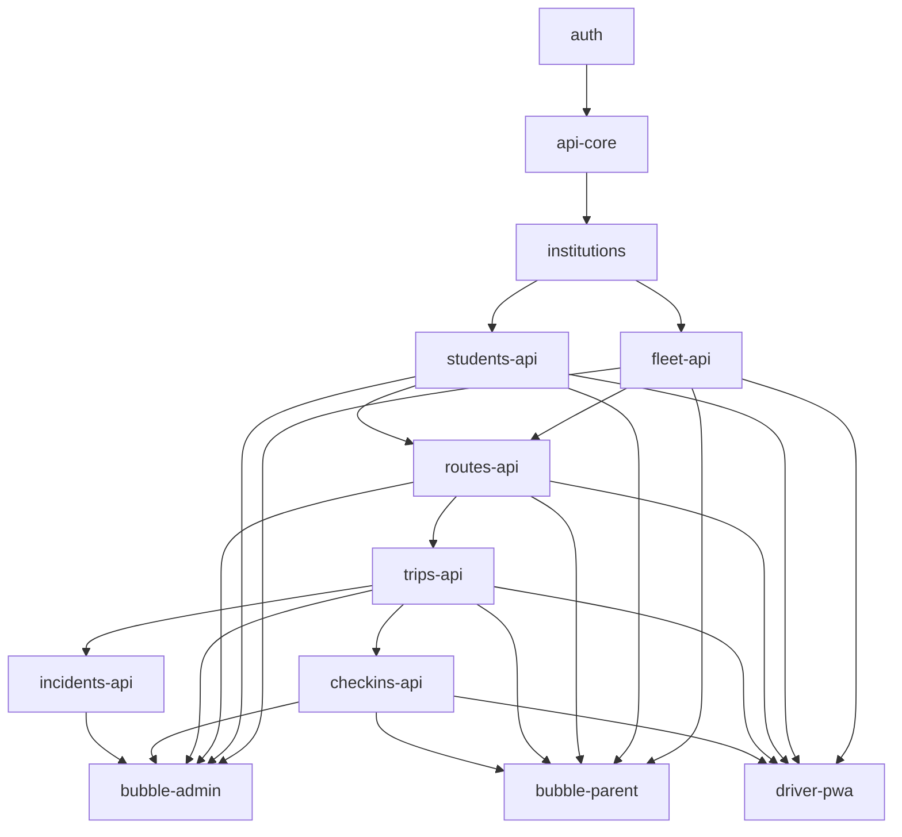

# Altaviapp Module Implementation Order

**Development Roadmap with Dependencies**
**Version**: 1.0
**Date**: January 2025
**Total Duration**: ~12 weeks (3 months)

---

## Overview

This document defines the recommended implementation order for Altaviapp modules. Each module builds on previous modules and cannot be started until its dependencies are complete.

**Module Types**:
- **Foundation** (Phase 1): Must be implemented first
- **Backend APIs** (Phase 2): Core business logic
- **Frontends** (Phase 3): User interfaces

**Implementation Strategy**:
- Sequential within phases (one module at a time)
- Can parallelize **some** modules within Phase 2 (see notes)
- All Phase 1 must be complete before Phase 2
- All Phase 2 must be complete before Phase 3

---

## Quick Reference: Module List

| # | Module | Phase | Duration | Dependencies |
|---|--------|-------|----------|--------------|
| 1 | auth | 1 | 3-5 days | None |
| 2 | api-core | 1 | 2-3 days | auth |
| 3 | institutions | 1 | 2-3 days | auth, api-core |
| 4 | fleet-api | 2 | 3-5 days | institutions |
| 5 | students-api | 2 | 4-6 days | institutions |
| 6 | routes-api | 2 | 5-7 days | institutions, fleet-api |
| 7 | trips-api | 2 | 5-7 days | routes-api, students-api |
| 8 | checkins-api | 2 | 3-5 days | trips-api |
| 9 | incidents-api | 2 | 3-4 days | trips-api |
| 10 | bubble-admin | 3 | 7-10 days | All Phase 2 |
| 11 | bubble-parent | 3 | 4-5 days | All Phase 2 |
| 12 | driver-pwa | 3 | 7-10 days | All Phase 2 |

**Total**: ~50-70 working days (10-14 weeks)

---

## Phase 1: Foundation (Week 1-2)

Must be implemented first. No dependencies outside this phase.

### Module 1: auth
**Duration**: 3-5 days
**Dependencies**: None (start here)

**What to implement**:
- Clerk SDK integration
- Clerk webhook handler (/auth/sync)
- User sync to Convex database
- getCurrentUser() helper
- requireRole() helper
- requireInstitutionAccess() helper
- JWT token validation

**Completion criteria**:
- [ ] Users can sign in with Clerk
- [ ] New users auto-create in Convex
- [ ] Role-based helpers work correctly
- [ ] Institution access control enforced

**Files to create**:
- `convex/http.ts` - Webhook handler
- `convex/lib/auth.ts` - Auth helpers
- `middleware.ts` - Clerk middleware (Next.js)

**Command**: `@implement auth`

---

### Module 2: api-core
**Duration**: 2-3 days
**Dependencies**: auth (must be complete)

**What to implement**:
- Standard response format (successResponse, errorResponse)
- Error classes (ApiError, BadRequestError, etc.)
- API route structure (/api/v1/*)
- Request validation setup (Zod)
- Error handling middleware
- CORS configuration

**Completion criteria**:
- [ ] Standard response format working
- [ ] Error handling consistent across endpoints
- [ ] CORS configured for Bubble.io
- [ ] Validation working with Zod

**Files to create**:
- `lib/api/response.ts`
- `lib/api/errors.ts`
- `lib/validations/common.ts`
- `app/api/v1/route.ts` (base route)

**Command**: `@implement api-core`

---

### Module 3: institutions
**Duration**: 2-3 days
**Dependencies**: auth, api-core

**What to implement**:
- Institutions table (already in schema)
- Institution CRUD endpoints:
  - GET /institutions
  - POST /institutions
  - GET /institutions/:id
  - PUT /institutions/:id
  - DELETE /institutions/:id
- Institution filtering for all future queries
- Super admin vs admin permissions

**Completion criteria**:
- [ ] Can create institutions (super_admin)
- [ ] Can list institutions (filtered by access)
- [ ] Can update/delete institutions
- [ ] Multi-tenancy foundation working

**Files to create**:
- `convex/institutions.ts` - Convex queries/mutations
- `app/api/v1/institutions/route.ts` - API endpoints
- `lib/validations/institution.ts` - Zod schemas

**Command**: `@implement institutions`

**End of Phase 1** ✅

---

## Phase 2: Backend APIs (Week 3-9)

Core business logic. **Cannot start until Phase 1 is 100% complete.**

### Module 4: fleet-api
**Duration**: 3-5 days
**Dependencies**: institutions

**What to implement**:
- Vehicles CRUD endpoints:
  - GET /vehicles
  - POST /vehicles
  - GET /vehicles/:id
  - PUT /vehicles/:id
  - DELETE /vehicles/:id
  - POST /vehicles/:id/upload-document
- Drivers CRUD endpoints:
  - GET /drivers
  - POST /drivers
  - GET /drivers/:id
  - PUT /drivers/:id
  - DELETE /drivers/:id
- Document upload (SOAT, technical review, licenses)
- Expiry date validation
- Status management (active/maintenance/retired)

**Completion criteria**:
- [ ] Can create/edit vehicles
- [ ] Can create/edit drivers
- [ ] Documents upload working
- [ ] Filtered by institutionId
- [ ] Status management working

**Files to create**:
- `convex/vehicles.ts`
- `convex/drivers.ts`
- `app/api/v1/vehicles/route.ts`
- `app/api/v1/drivers/route.ts`
- `lib/validations/vehicle.ts`
- `lib/validations/driver.ts`

**Command**: `@implement fleet-api`

---

### Module 5: students-api
**Duration**: 4-6 days
**Dependencies**: institutions

**What to implement**:
- Students CRUD endpoints:
  - GET /students
  - POST /students (with QR generation)
  - GET /students/:id
  - PUT /students/:id
  - DELETE /students/:id
  - GET /students/:id/qr
  - POST /students/:id/regenerate-qr
- QR code generation (qrcode library)
- QR code validation
- Parent information management
- Emergency contacts
- Medical information
- Authorized pickup persons

**Completion criteria**:
- [ ] Can create students
- [ ] QR codes auto-generated
- [ ] QR codes can be regenerated
- [ ] Parent info properly stored
- [ ] Medical info optional but validated

**Files to create**:
- `convex/students.ts`
- `app/api/v1/students/route.ts`
- `lib/validations/student.ts`
- `lib/qr-generator.ts`

**Command**: `@implement students-api`

**Note**: Can be parallelized with fleet-api (different branches)

---

### Module 6: routes-api
**Duration**: 5-7 days
**Dependencies**: institutions, fleet-api

**What to implement**:
- Routes CRUD endpoints:
  - GET /routes
  - POST /routes
  - GET /routes/:id
  - PUT /routes/:id
  - DELETE /routes/:id
- Route Stops endpoints:
  - GET /routes/:routeId/stops
  - POST /routes/:routeId/stops
  - GET /routes/:routeId/stops/:stopId
  - PUT /routes/:routeId/stops/:stopId
  - DELETE /routes/:routeId/stops/:stopId
  - PUT /routes/:routeId/stops/reorder
- Geofencing calculation
- Route distance calculation (OSRM or manual)
- Stop ordering
- Capacity management

**Completion criteria**:
- [ ] Can create routes
- [ ] Can add stops to routes
- [ ] Stops can be reordered
- [ ] Geofencing radius configurable
- [ ] Route capacity tracked

**Files to create**:
- `convex/routes.ts`
- `convex/routeStops.ts`
- `app/api/v1/routes/route.ts`
- `app/api/v1/routes/[routeId]/stops/route.ts`
- `lib/validations/route.ts`
- `lib/geofence.ts`

**Command**: `@implement routes-api`

---

### Module 7: trips-api
**Duration**: 5-7 days
**Dependencies**: routes-api, students-api

**What to implement**:
- Trips CRUD endpoints:
  - GET /trips
  - POST /trips
  - GET /trips/:id
  - PUT /trips/:id
  - PUT /trips/:id/start
  - PUT /trips/:id/complete
  - PUT /trips/:id/cancel
  - GET /trips/active
- GPS tracking endpoints:
  - POST /trips/:tripId/location
  - GET /trips/:tripId/location
  - GET /trips/:tripId/location/history
- Student Routes endpoints:
  - POST /student-routes (assign student to route)
  - GET /student-routes/:id
  - PUT /student-routes/:id
  - DELETE /student-routes/:id
- Real-time location updates (Convex live queries)
- Geofencing detection on GPS update
- Trip status management
- Pre-trip checklist

**Completion criteria**:
- [ ] Can create trips
- [ ] Can start/complete/cancel trips
- [ ] GPS updates working
- [ ] Real-time location retrieval
- [ ] Geofencing triggers correctly
- [ ] Student route assignments working

**Files to create**:
- `convex/trips.ts`
- `convex/gpsTracking.ts`
- `convex/studentRoutes.ts`
- `convex/geofencing.ts` (internal)
- `app/api/v1/trips/route.ts`
- `app/api/v1/student-routes/route.ts`
- `lib/validations/trip.ts`

**Command**: `@implement trips-api`

---

### Module 8: checkins-api
**Duration**: 3-5 days
**Dependencies**: trips-api

**What to implement**:
- Check-ins endpoints:
  - POST /checkins
  - POST /checkins/validate-qr
  - GET /checkins
  - GET /checkins/:id
- QR code validation
- Parent notification trigger (WhatsApp)
- Location verification
- Manual vs QR check-in tracking
- Dropoff authorization (authorized persons)

**Completion criteria**:
- [ ] Can record check-ins
- [ ] QR validation working
- [ ] Parent notifications sent (WhatsApp)
- [ ] Location recorded with check-in
- [ ] Authorized person validation

**Files to create**:
- `convex/checkins.ts`
- `convex/notifications.ts` (WhatsApp)
- `app/api/v1/checkins/route.ts`
- `lib/validations/checkin.ts`
- `lib/qr-validator.ts`

**Command**: `@implement checkins-api`

---

### Module 9: incidents-api
**Duration**: 3-4 days
**Dependencies**: trips-api

**What to implement**:
- Incidents endpoints:
  - GET /incidents
  - POST /incidents
  - GET /incidents/:id
  - PUT /incidents/:id
  - PUT /incidents/:id/resolve
  - POST /incidents/:id/upload-photo
- Incident classification (type, severity, category)
- Photo upload
- Emergency notifications
- Status workflow (open → investigating → resolved → closed)

**Completion criteria**:
- [ ] Can create incident reports
- [ ] Photos can be uploaded
- [ ] Emergency incidents trigger alerts
- [ ] Status workflow functional
- [ ] Notifications sent to admins

**Files to create**:
- `convex/incidents.ts`
- `app/api/v1/incidents/route.ts`
- `lib/validations/incident.ts`

**Command**: `@implement incidents-api`

**End of Phase 2** ✅

---

## Phase 3: Frontends (Week 10-12)

User interfaces. **Cannot start until Phase 2 is 100% complete.**

### Module 10: bubble-admin
**Duration**: 7-10 days
**Dependencies**: All Phase 2 modules

**What to implement**:
- Admin dashboard pages (Bubble.io):
  - Dashboard overview (metrics, alerts)
  - Fleet management (vehicles, drivers)
  - Route management (routes, stops, assignments)
  - Student management (students, QR codes)
  - Trip monitoring (active trips, history)
  - Incident management (reports, investigations)
  - Reports and analytics
  - Settings and configuration
- API connector setup
- Workflows for all CRUD operations
- Real-time data display
- Filters and search

**Completion criteria**:
- [ ] All pages functional
- [ ] All API calls working
- [ ] CRUD operations complete
- [ ] Real-time data updating
- [ ] Responsive design
- [ ] Admin can manage entire system

**Files to create**:
- Bubble.io app pages (no code files)
- Documentation: Update BUBBLE_SETUP_GUIDE.md with actual page structures

**Command**: `@implement bubble-admin`

**Reference**: [docs/bubble/BUBBLE_SETUP_GUIDE.md](../bubble/BUBBLE_SETUP_GUIDE.md)

---

### Module 11: bubble-parent
**Duration**: 4-5 days
**Dependencies**: All Phase 2 modules

**What to implement**:
- Parent portal pages (Bubble.io):
  - Login/signup
  - Student dashboard
  - Real-time tracking (map view)
  - Notification history
  - Trip history
  - Contact information
- Real-time GPS display (auto-refresh every 15s)
- Route progress visualization
- ETA calculation
- WhatsApp notification history

**Completion criteria**:
- [ ] Parents can log in
- [ ] Can view their students
- [ ] Can track bus in real-time
- [ ] Notifications display correctly
- [ ] Map updates automatically
- [ ] Mobile-responsive

**Files to create**:
- Bubble.io app pages
- Documentation updates

**Command**: `@implement bubble-parent`

**Note**: Can be parallelized with bubble-admin (different Bubble apps or pages)

---

### Module 12: driver-pwa
**Duration**: 7-10 days
**Dependencies**: All Phase 2 modules

**What to implement**:
- Driver mobile PWA (Next.js):
  - Login page
  - Route selection page
  - Active trip page
  - Pre-trip checklist page
  - Student check-in page (QR scanner)
  - Incident report page
  - Trip history page
- GPS tracking (continuous background updates)
- QR code scanner (camera access)
- Offline functionality:
  - Service worker
  - IndexedDB for route/student data
  - Background sync for check-ins
  - Queued GPS updates
- Push notifications
- PWA manifest
- Install prompt

**Completion criteria**:
- [ ] Driver can log in
- [ ] Can select and start routes
- [ ] GPS tracking functional
- [ ] QR scanner working
- [ ] Can check in students offline
- [ ] Data syncs when back online
- [ ] Can install as app
- [ ] Push notifications working

**Files to create**:
- `app/driver/*` - Driver app pages
- `components/driver/*` - Driver components
- `lib/offline-storage.ts`
- `lib/gps-tracker.ts`
- `lib/qr-scanner.ts`
- `public/sw.js` - Service worker
- `public/manifest.json` - PWA manifest

**Command**: `@implement driver-pwa`

**End of Phase 3** ✅

---

## Dependency Visualization

### ASCII Dependency Tree

```
Phase 1 (Foundation)
  auth
    ↓
  api-core
    ↓
  institutions

Phase 2 (Backend)
  institutions
    ↓
    ├─→ fleet-api
    │     ↓
    │   routes-api ←──┐
    │     ↓           │
    └─→ students-api ─┘
          ↓
        trips-api
          ↓
          ├─→ checkins-api
          └─→ incidents-api

Phase 3 (Frontends)
  [All Phase 2 complete]
    ↓
    ├─→ bubble-admin
    ├─→ bubble-parent
    └─→ driver-pwa
```

### Mermaid Diagram



---

## Parallelization Opportunities

### Can Be Parallelized (Different Branches)

**Phase 2**:
- `fleet-api` and `students-api` (no dependencies on each other)
  - Branch 1: `feature/fleet-api`
  - Branch 2: `feature/students-api`
  - Merge both before starting `routes-api`

**Phase 3**:
- `bubble-admin` and `bubble-parent` (separate Bubble apps/pages)
  - Branch 1: `feature/bubble-admin`
  - Branch 2: `feature/bubble-parent`
- `driver-pwa` can run in parallel with Bubble work
  - Branch 3: `feature/driver-pwa`

### Cannot Be Parallelized (Sequential)

**Phase 1**: All sequential
- auth → api-core → institutions

**Phase 2 (partial)**:
- routes-api depends on fleet-api completion
- trips-api depends on routes-api AND students-api completion
- checkins-api and incidents-api depend on trips-api

---

## Critical Path

**Longest dependency chain (critical path)**:

```
auth (5d) →
api-core (3d) →
institutions (3d) →
fleet-api (5d) →
routes-api (7d) →
trips-api (7d) →
checkins-api (5d) →
bubble-admin (10d)

Total Critical Path: ~45 days (9 weeks)
```

**With parallelization**:
- fleet-api || students-api: Save 5 days
- All Phase 3 in parallel: Save ~5 days

**Optimized total**: ~35-40 days (7-8 weeks) with 2-3 developers

---

## Weekly Breakdown

### Week 1
- [ ] auth (3-5 days)
- [ ] api-core (2-3 days)

### Week 2
- [ ] institutions (2-3 days)
- [ ] fleet-api (start, 3-5 days)

### Week 3
- [ ] fleet-api (complete)
- [ ] students-api (start, 4-6 days) [parallel with fleet-api end]

### Week 4
- [ ] students-api (complete)
- [ ] routes-api (start, 5-7 days)

### Week 5
- [ ] routes-api (complete)
- [ ] trips-api (start, 5-7 days)

### Week 6-7
- [ ] trips-api (complete)
- [ ] checkins-api (3-5 days)
- [ ] incidents-api (3-4 days) [parallel with checkins-api]

### Week 8-9
- [ ] bubble-admin (7-10 days)

### Week 10
- [ ] bubble-parent (4-5 days)

### Week 11-12
- [ ] driver-pwa (7-10 days) [parallel with Bubble work]

**Total**: 12 weeks (3 months)

---

## Blockers and Risks

### Potential Blockers

1. **Clerk setup delays** (Module 1)
   - Mitigation: Set up Clerk account and keys before starting

2. **Convex schema issues** (Module 3)
   - Mitigation: Schema already defined, just need to deploy

3. **QR code library integration** (Module 5)
   - Mitigation: Test QR generation early

4. **GPS tracking accuracy** (Module 7)
   - Mitigation: Test on real devices early

5. **Bubble.io API connector limits** (Modules 10-11)
   - Mitigation: Understand Bubble limits, optimize API calls

6. **PWA offline sync complexity** (Module 12)
   - Mitigation: Prototype service worker early

### Risk Mitigation Strategies

- **Start each module with spike/prototype** for complex features
- **Test on real devices** for GPS and QR features
- **Get Bubble.io familiarity** before Phase 3
- **Set up CI/CD early** to catch integration issues
- **Regular testing** after each module completion

---

## Success Criteria

### Per Module
- [ ] All features from PRD implemented
- [ ] Tests written and passing
- [ ] PR merged to main
- [ ] Documentation updated
- [ ] No blocking bugs

### Per Phase
- [ ] All modules in phase complete
- [ ] Integration testing passed
- [ ] Demo to stakeholders successful
- [ ] Ready for next phase

### Overall Project
- [ ] All 12 modules complete
- [ ] End-to-end testing passed
- [ ] Performance requirements met
- [ ] Security audit passed
- [ ] Ready for production deployment

---

## Quick Commands Reference

```bash
# Phase 1
@implement auth
@implement api-core
@implement institutions

# Phase 2
@implement fleet-api
@implement students-api
@implement routes-api
@implement trips-api
@implement checkins-api
@implement incidents-api

# Phase 3
@implement bubble-admin
@implement bubble-parent
@implement driver-pwa
```

---

**This implementation order ensures smooth, dependency-aware development of Altaviapp!** 🚀

Follow this sequence, check off modules as you complete them, and track progress using PRs.

**See also**:
- [CLAUDE.md](../../CLAUDE.md) - Agent commands
- [MODULE_CHECKLIST.md](MODULE_CHECKLIST.md) - Requirements per module
- [docs/PRD.md](../PRD.md) - Feature requirements
