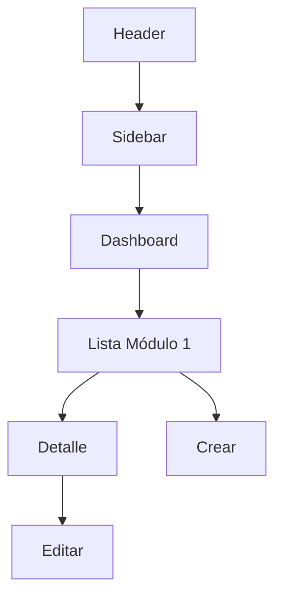

# {APP_NAME} - Historias de Usuario y Wireframes

**App**: {Nombre completo de la app}
**Versión**: 1.0
**Fecha**: {Fecha}
**PRD Referencia**: [PRD v2](../prd-v2/{APP}_PRD.md)

---

## Tabla de Contenidos

1. [Resumen de Historias](#resumen-de-historias)
2. [Flujo de Desarrollo](#flujo-de-desarrollo)
3. [Dependencias](#dependencias)
4. [Componentes Reutilizables](#componentes-reutilizables)
5. [Historias por Módulo](#historias-por-módulo)

---

## Resumen de Historias

| Código | Historia | Prioridad | Estimación | Estado |
|--------|----------|-----------|------------|--------|
| {APP}-GLOB-001 | Header con notificaciones | Alta | M | - |
| {APP}-GLOB-002 | Sidebar/Navigation | Alta | M | - |
| ... | ... | ... | ... | ... |

**Total**: X historias
**Estimación total**: Y puntos

---

## Flujo de Desarrollo

```
Fase 1: Fundamentos
├── AUTH-001 → AUTH-002 → AUTH-003
└── GLOB-001 → GLOB-002 → GLOB-003

Fase 2: Módulo Core 1
├── MOD1-001 (lista)
├── MOD1-002 (detalle) ← depende de MOD1-001
├── MOD1-003 (crear) ← depende de MOD1-001
└── MOD1-004 (editar) ← depende de MOD1-002

Fase 3: Módulo Core 2
└── ...
```

---

## Dependencias



| Historia | Depende de | Bloquea |
|----------|------------|---------|
| GLOB-001 | - | GLOB-002, todas las páginas |
| GLOB-002 | GLOB-001 | Todas las páginas |
| MOD1-002 | MOD1-001 | MOD1-004 |
| ... | ... | ... |

---

## Componentes Reutilizables

### DataTable
```
┌─────────────────────────────────────────────────────────────────────────┐
│ [🔍 Buscar...________] [Filtro ▼] [+ Nuevo]                             │
├───────┬──────────────────────┬────────────┬─────────────┬───────────────┤
│ □     │ Columna 1 ↕          │ Columna 2  │ Columna 3   │ Acciones      │
├───────┼──────────────────────┼────────────┼─────────────┼───────────────┤
│ □     │ Valor 1              │ Valor 2    │ (badge)     │ [👁] [✏] [🗑] │
│ □     │ Valor 1              │ Valor 2    │ (badge)     │ [👁] [✏] [🗑] │
│ □     │ Valor 1              │ Valor 2    │ (badge)     │ [👁] [✏] [🗑] │
├───────┴──────────────────────┴────────────┴─────────────┴───────────────┤
│ Mostrando 1-10 de 50                              [<] [1] [2] [3] [>]   │
└─────────────────────────────────────────────────────────────────────────┘
```

**Props**:
- `columns`: Definición de columnas
- `data`: Array de datos
- `onRowClick`: Handler de click en fila
- `actions`: Acciones por fila
- `searchable`: Habilitar búsqueda
- `filterable`: Habilitar filtros
- `pagination`: Configuración de paginación

**Usado en**: Lista de vehículos, conductores, estudiantes, rutas, viajes, usuarios

---

### StatCard
```
┌─────────────────────────┐
│ [icon]                  │
│ 42                      │
│ Viajes Activos          │
│ ↑ 12% vs ayer           │
└─────────────────────────┘
```

**Props**:
- `icon`: Icono del stat
- `value`: Valor numérico
- `label`: Etiqueta
- `trend`: Opcional, cambio porcentual
- `color`: Color del tema

**Usado en**: Dashboard, páginas de lista

---

### FormWizard
```
┌─────────────────────────────────────────────────────────────────────────┐
│                    (1)────────(2)────────(3)                            │
│                   Paso 1     Paso 2     Paso 3                          │
│                   ●──────────○──────────○                               │
├─────────────────────────────────────────────────────────────────────────┤
│                                                                         │
│  Contenido del paso actual                                              │
│                                                                         │
│                                                                         │
├─────────────────────────────────────────────────────────────────────────┤
│ [← Anterior]                                              [Siguiente →] │
└─────────────────────────────────────────────────────────────────────────┘
```

**Props**:
- `steps`: Array de definición de pasos
- `currentStep`: Paso actual
- `onNext`: Handler siguiente
- `onPrevious`: Handler anterior
- `onComplete`: Handler al completar

**Usado en**: Crear ruta, importar estudiantes, crear novedad

---

### ConfirmDialog
```
┌─────────────────────────────────────────┐
│ ⚠️ Confirmar acción                 [x] │
├─────────────────────────────────────────┤
│                                         │
│ ¿Estás seguro de que deseas eliminar    │
│ este vehículo?                          │
│                                         │
│ Esta acción no se puede deshacer.       │
│                                         │
├─────────────────────────────────────────┤
│           [Cancelar]  [Eliminar]        │
└─────────────────────────────────────────┘
```

**Props**:
- `title`: Título
- `message`: Mensaje
- `confirmText`: Texto del botón confirmar
- `cancelText`: Texto del botón cancelar
- `variant`: default | danger | warning
- `onConfirm`: Handler confirmar
- `onCancel`: Handler cancelar

---

### EmptyState
```
┌─────────────────────────────────────────────────────────────────────────┐
│                                                                         │
│                              [ilustración]                              │
│                                                                         │
│                        No hay vehículos                                 │
│                                                                         │
│              Agrega tu primer vehículo para comenzar                    │
│                                                                         │
│                         [+ Agregar vehículo]                            │
│                                                                         │
└─────────────────────────────────────────────────────────────────────────┘
```

**Props**:
- `icon`: Icono o ilustración
- `title`: Título
- `description`: Descripción
- `action`: Botón de acción opcional

---

### LoadingState
```
┌─────────────────────────────────────────────────────────────────────────┐
│                                                                         │
│                            ◐ Cargando...                                │
│                                                                         │
└─────────────────────────────────────────────────────────────────────────┘
```

O skeleton:
```
┌─────────────────────────────────────────────────────────────────────────┐
│ ░░░░░░░░░░░░░░░░                                                        │
├───────┬──────────────────────┬────────────┬─────────────┬───────────────┤
│ ░░    │ ░░░░░░░░░░░░░░░░░░░  │ ░░░░░░░░░  │ ░░░░░░░░░░  │ ░░░░░░░░░░░  │
│ ░░    │ ░░░░░░░░░░░░░░░░░░░  │ ░░░░░░░░░  │ ░░░░░░░░░░  │ ░░░░░░░░░░░  │
│ ░░    │ ░░░░░░░░░░░░░░░░░░░  │ ░░░░░░░░░  │ ░░░░░░░░░░  │ ░░░░░░░░░░░  │
└───────┴──────────────────────┴────────────┴─────────────┴───────────────┘
```

---

### ErrorState
```
┌─────────────────────────────────────────────────────────────────────────┐
│                                                                         │
│                              ⚠️                                         │
│                                                                         │
│                   Error al cargar los datos                             │
│                                                                         │
│              Por favor, intenta de nuevo más tarde                      │
│                                                                         │
│                         [Reintentar]                                    │
│                                                                         │
└─────────────────────────────────────────────────────────────────────────┘
```

---

### Badge
```
Variantes:
(activo)     → Verde
(inactivo)   → Gris
(pendiente)  → Amarillo
(error)      → Rojo
(info)       → Azul

Con icono:
(✓ Aprobado)
(⏳ Pendiente)
(✗ Rechazado)
```

---

### Toast/Notification
```
Posición: Top-right

┌─────────────────────────────────────────┐
│ ✓ Vehículo creado exitosamente      [x] │
└─────────────────────────────────────────┘

Variantes:
- success (verde)
- error (rojo)
- warning (amarillo)
- info (azul)

Auto-dismiss: 5 segundos
```

---

## Historias por Módulo

---

# Módulo: Componentes Globales

---

## {APP}-GLOB-001: Header con Notificaciones

**Épica**: Componentes Globales
**Prioridad**: Alta
**Estimación**: M
**Depende de**: -
**Bloquea**: Todas las páginas

### Descripción

Como {rol}, quiero ver un header persistente con acceso a notificaciones, para estar informado de eventos importantes sin salir de mi vista actual.

### Criterios de Aceptación

- [ ] Header visible en todas las páginas autenticadas
- [ ] Logo de la app a la izquierda
- [ ] Título de la página actual en el centro (desktop) o izquierda (mobile)
- [ ] Campana de notificaciones con badge de conteo
- [ ] Avatar/iniciales del usuario con dropdown de opciones
- [ ] Badge desaparece cuando no hay notificaciones no leídas
- [ ] Dropdown de notificaciones muestra últimas 10
- [ ] Click en notificación navega al recurso y marca como leída
- [ ] Responsive: en mobile, menú hamburguesa reemplaza sidebar

### Wireframe - Desktop

```
┌─────────────────────────────────────────────────────────────────────────────┐
│                                                                             │
│  [Logo] Altaviapp {App}          {Título Página}           🔔(3)  [JD ▼]   │
│                                                                             │
└─────────────────────────────────────────────────────────────────────────────┘
```

### Wireframe - Mobile

```
┌─────────────────────────────────────────┐
│ [≡]  {Título}              🔔(3)  [JD]  │
└─────────────────────────────────────────┘
```

### Wireframe - Dropdown Notificaciones

```
                                          ┌───────────────────────────────┐
                                          │ Notificaciones            [x] │
                                          ├───────────────────────────────┤
                                          │ ● [icon] Título notificación  │
                                          │   Descripción breve...        │
                                          │   Hace 5 min                  │
                                          ├───────────────────────────────┤
                                          │ ● [icon] Título notificación  │
                                          │   Descripción breve...        │
                                          │   Hace 12 min                 │
                                          ├───────────────────────────────┤
                                          │ ○ [icon] Título notificación  │
                                          │   Descripción breve...        │
                                          │   Hace 1 hora                 │
                                          ├───────────────────────────────┤
                                          │ [Marcar todas como leídas]    │
                                          │ [Ver todas las notificaciones]│
                                          └───────────────────────────────┘
```

### Wireframe - Dropdown Usuario

```
                                                    ┌─────────────────────┐
                                                    │ Juan Pérez          │
                                                    │ admin@escuela.com   │
                                                    ├─────────────────────┤
                                                    │ [👤] Mi Perfil      │
                                                    │ [⚙] Configuración   │
                                                    ├─────────────────────┤
                                                    │ [↪] Cerrar Sesión   │
                                                    └─────────────────────┘
```

### Estados de UI

| Estado | Visualización |
|--------|---------------|
| Sin notificaciones | Campana sin badge, dropdown: "No hay notificaciones nuevas" |
| Con no leídas | Badge con número (max "9+"), lista con puntos azules |
| Cargando | Skeleton en dropdown |
| Error | "Error al cargar" + botón reintentar |

### Interacciones

| Elemento | Acción | Resultado |
|----------|--------|-----------|
| Logo | Click | Navega a Dashboard |
| Campana | Click | Toggle dropdown notificaciones |
| Notificación | Click | Navega a recurso, marca como leída, cierra dropdown |
| "Marcar todas" | Click | Todas → leídas, badge desaparece |
| "Ver todas" | Click | Navega a /notifications (si existe) |
| Avatar | Click | Toggle dropdown usuario |
| "Mi Perfil" | Click | Navega a /profile |
| "Configuración" | Click | Navega a /settings |
| "Cerrar Sesión" | Click | Logout, navega a /login |
| Click fuera | Click | Cierra cualquier dropdown abierto |
| Hamburguesa (mobile) | Click | Toggle sidebar |

### Datos Requeridos

| Campo | Tipo | Fuente | Actualización |
|-------|------|--------|---------------|
| user | object | useCurrentUser() | Una vez |
| notifications | array | useUnreadNotifications(10) | Real-time |
| unreadCount | number | useUnreadCount() | Real-time |
| pageTitle | string | Router/Context | Por navegación |

### Funciones/Acciones

| Función | Trigger | Parámetros | Efecto |
|---------|---------|------------|--------|
| markAsRead | Click notificación | notificationId | Actualiza estado en DB |
| markAllAsRead | Click botón | userId | Actualiza todas en DB |
| logout | Click cerrar sesión | - | Limpia token, redirige a login |
| navigate | Click en item | path | Cambia ruta |

### Notas de Implementación

- Usar `position: sticky` para mantener visible
- Z-index alto para estar sobre contenido
- Transiciones suaves para dropdowns
- Click outside handler para cerrar
- Notificaciones con polling o subscription real-time

---

## {APP}-GLOB-002: Sidebar de Navegación

**Épica**: Componentes Globales
**Prioridad**: Alta
**Estimación**: M
**Depende de**: GLOB-001
**Bloquea**: Todas las páginas

### Descripción

Como {rol}, quiero una barra de navegación lateral con acceso a todos los módulos, para poder moverme eficientemente entre secciones de la aplicación.

### Criterios de Aceptación

- [ ] Sidebar visible en desktop, oculto en mobile (toggle desde header)
- [ ] Items de navegación con icono y texto
- [ ] Item activo visualmente destacado
- [ ] Hover state en items
- [ ] Opción de colapsar a solo iconos (desktop)
- [ ] Footer con link a configuración y logout
- [ ] Badge en items que requieren atención (ej: novedades pendientes)

### Wireframe - Expandido (Desktop)

```
┌──────────────────────────┐
│                          │
│  [Logo] Altaviapp        │
│         {App}            │
│                          │
├──────────────────────────┤
│                          │
│  [icon] Dashboard        │
│                          │
│  [icon] Flota        [>] │
│  [icon] Estudiantes      │
│  [icon] Rutas            │
│  [icon] Viajes           │
│  [icon] Incidentes   (2) │
│  [icon] Solicitudes  (5) │
│  [icon] Usuarios         │
│                          │
│                          │
│                          │
├──────────────────────────┤
│  [icon] Configuración    │
│  [icon] Cerrar Sesión    │
└──────────────────────────┘
```

### Wireframe - Colapsado (Desktop)

```
┌──────┐
│ [L]  │
├──────┤
│ [📊] │
│ [🚗] │
│ [👥] │
│ [🛣] │
│ [🚌] │
│ [⚠]2│
│ [📋]5│
│ [👤] │
│      │
├──────┤
│ [⚙] │
│ [↪] │
└──────┘
```

### Wireframe - Mobile (Overlay)

```
┌─────────────────────────────────────────┐
│ [x]  Menú                               │
├─────────────────────────────────────────┤
│                                         │
│  [👤] Juan Pérez                        │
│       admin@escuela.com                 │
│                                         │
├─────────────────────────────────────────┤
│                                         │
│  [icon] Dashboard                       │
│  [icon] Flota                           │
│  [icon] Estudiantes                     │
│  [icon] Rutas                           │
│  [icon] Viajes                          │
│  [icon] Incidentes               (2)    │
│  [icon] Solicitudes              (5)    │
│  [icon] Usuarios                        │
│                                         │
├─────────────────────────────────────────┤
│  [icon] Configuración                   │
│  [icon] Cerrar Sesión                   │
└─────────────────────────────────────────┘

(Fondo oscurecido detrás)
```

### Wireframe - Submenu Flota

```
┌──────────────────────────┐
│  [icon] Flota        [v] │
│    ├─ Vehículos          │
│    ├─ Conductores        │
│    └─ Monitores          │
└──────────────────────────┘
```

### Estados de UI

| Estado | Visualización |
|--------|---------------|
| Item activo | Background highlight, borde izquierdo accent |
| Item hover | Background sutil |
| Colapsado | Solo iconos, tooltip en hover |
| Mobile cerrado | No visible |
| Mobile abierto | Overlay sobre contenido |

### Interacciones

| Elemento | Acción | Resultado |
|----------|--------|-----------|
| Item de navegación | Click | Navega a la ruta, cierra mobile sidebar |
| Item con submenu | Click | Expande/colapsa submenu |
| Botón colapsar | Click | Toggle expandido/colapsado |
| Botón cerrar (mobile) | Click | Cierra sidebar |
| Overlay (mobile) | Click | Cierra sidebar |
| Esc key | Keydown | Cierra sidebar mobile |

### Datos Requeridos

| Campo | Tipo | Fuente | Actualización |
|-------|------|--------|---------------|
| currentPath | string | Router | Por navegación |
| pendingNovedadesCount | number | usePendingNovedadesCount() | Real-time |
| openIncidentsCount | number | useOpenIncidentsCount() | Real-time |
| isCollapsed | boolean | localStorage + state | Por acción usuario |
| isMobileOpen | boolean | state | Por acción usuario |

### Funciones/Acciones

| Función | Trigger | Parámetros | Efecto |
|---------|---------|------------|--------|
| navigate | Click item | path | Cambia ruta |
| toggleCollapse | Click botón | - | Toggle estado colapsado |
| toggleMobile | Click hamburguesa/cerrar | - | Toggle mobile sidebar |
| toggleSubmenu | Click item con hijos | menuKey | Expande/colapsa |

### Notas de Implementación

- Estado colapsado persistido en localStorage
- Animación suave al colapsar/expandir
- En mobile: `position: fixed`, `z-index` alto
- Trap focus cuando mobile sidebar está abierto
- Cerrar al navegar en mobile

---

# Módulo: {NOMBRE_MÓDULO}

---

## {APP}-{MOD}-001: {Nombre de la Historia}

**Épica**: {Módulo}
**Prioridad**: Alta | Media | Baja
**Estimación**: XS | S | M | L | XL
**Depende de**: {códigos}
**Bloquea**: {códigos}

### Descripción

Como {rol}, quiero {acción}, para {beneficio}.

### Criterios de Aceptación

- [ ] Criterio 1
- [ ] Criterio 2
- [ ] Criterio 3
- [ ] ...

### Wireframe

```
┌─────────────────────────────────────────────────────────────────────────────┐
│ Header                                                                      │
├────────────────────┬────────────────────────────────────────────────────────┤
│                    │                                                        │
│  Sidebar           │  Contenido Principal                                   │
│                    │                                                        │
│                    │  ┌────────────────────────────────────────────────┐   │
│                    │  │                                                │   │
│                    │  │  Sección 1                                     │   │
│                    │  │                                                │   │
│                    │  └────────────────────────────────────────────────┘   │
│                    │                                                        │
│                    │  ┌────────────────────────────────────────────────┐   │
│                    │  │                                                │   │
│                    │  │  Sección 2                                     │   │
│                    │  │                                                │   │
│                    │  └────────────────────────────────────────────────┘   │
│                    │                                                        │
└────────────────────┴────────────────────────────────────────────────────────┘
```

### Estados de UI

| Estado | Visualización |
|--------|---------------|
| Loading | Descripción |
| Empty | Descripción |
| Error | Descripción |
| Success | Descripción |

### Interacciones

| Elemento | Acción | Resultado |
|----------|--------|-----------|
| Elemento 1 | Click | Resultado |
| Elemento 2 | Hover | Resultado |
| ... | ... | ... |

### Datos Requeridos

| Campo | Tipo | Fuente | Actualización |
|-------|------|--------|---------------|
| campo1 | tipo | hook/query | frecuencia |
| campo2 | tipo | hook/query | frecuencia |

### Funciones/Acciones

| Función | Trigger | Parámetros | Efecto |
|---------|---------|------------|--------|
| función1 | evento | params | efecto |
| función2 | evento | params | efecto |

### Validaciones

| Campo | Regla | Mensaje de Error |
|-------|-------|------------------|
| campo1 | regla | mensaje |
| campo2 | regla | mensaje |

### Navegación

- **Viene de**: /ruta-anterior o Lista de X
- **Va a**: /ruta-siguiente o Detalle de X
- **Breadcrumb**: Home > Módulo > Esta Página

### Notas de Implementación

- Nota 1
- Nota 2

---

## Apéndice: Guía de Wireframes ASCII

### Caracteres Básicos

```
Bordes:
┌ ┐ └ ┘ ─ │ ├ ┤ ┬ ┴ ┼

Elementos:
[Botón]           → Botón clickeable
[____input____]   → Campo de texto
[▼]               → Dropdown cerrado
[icon]            → Placeholder de icono
(badge)           → Badge/etiqueta
●                 → Bullet/indicador activo
○                 → Bullet/indicador inactivo
✓                 → Check
✗                 → Error/cerrar
...               → Contenido truncado
░░░░░░            → Skeleton/loading
```

### Patrones Comunes

**Card**:
```
┌─────────────────────────────┐
│ Título                      │
├─────────────────────────────┤
│ Contenido                   │
│                             │
├─────────────────────────────┤
│ Footer con acciones         │
└─────────────────────────────┘
```

**Form Field**:
```
Label *
[____placeholder____]
Texto de ayuda

Label con error *
[____valor_______] ⚠
Este campo es requerido
```

**Tabs**:
```
┌─────────┬─────────┬─────────┐
│ Tab 1   │ Tab 2   │ Tab 3   │
├─────────┴─────────┴─────────┤
│ Contenido del tab activo    │
└─────────────────────────────┘
```

**Modal**:
```
╔═════════════════════════════════════╗
║ Título del Modal              [x]   ║
╠═════════════════════════════════════╣
║                                     ║
║  Contenido del modal                ║
║                                     ║
╠═════════════════════════════════════╣
║         [Cancelar]  [Confirmar]     ║
╚═════════════════════════════════════╝
```

**List Item**:
```
├─────────────────────────────────────┤
│ [img] Título                 (badge)│
│       Subtítulo             [acción]│
├─────────────────────────────────────┤
```

---

## Apéndice: Estimaciones

| Tamaño | Descripción | Tiempo Aprox |
|--------|-------------|--------------|
| XS | Cambio mínimo, sin lógica | 1-2 horas |
| S | Componente simple | 2-4 horas |
| M | Página o feature estándar | 4-8 horas |
| L | Feature complejo, múltiples componentes | 1-2 días |
| XL | Módulo completo, flujos complejos | 2-4 días |
